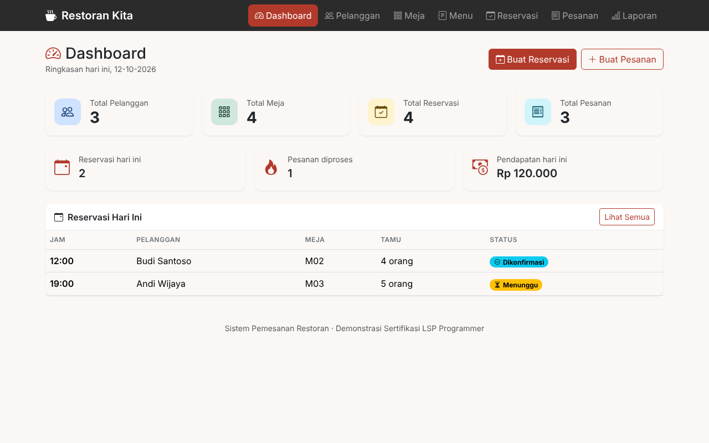

# Sistem Pemesanan Restoran

Aplikasi web sederhana untuk praktik demonstrasi **Sertifikasi LSP Programmer**. Aplikasi ini mencatat data pelanggan, meja, menu, reservasi meja, dan pesanan, serta menampilkan laporan yang bisa dicetak.

Spesifikasi lengkap ada di [`PRD-SPEC-LSP-Programmer-Sistem-Pemesanan-Restoran.md`](PRD-SPEC-LSP-Programmer-Sistem-Pemesanan-Restoran.md).



Screenshot lainnya ada di [`docs/screenshots/`](docs/screenshots/).

## Fitur

- **Dashboard**: total pelanggan, meja, reservasi, dan pesanan; reservasi hari ini, pesanan yang sedang diproses, dan pendapatan hari ini; tombol cepat Buat Reservasi / Buat Pesanan.
- **Pelanggan, Meja, Menu**: tambah, ubah, hapus, dan cari. Nomor telepon pelanggan harus unik. Data yang masih dipakai data lain tidak bisa dihapus, dan aplikasi menampilkan pesan yang jelas. Meja yang masih punya reservasi aktif mendatang tidak bisa dinonaktifkan.
- **Reservasi**: daftar dengan filter Hari Ini / Akan Datang / Semua dan filter status. Aturannya:
  - reservasi baru selalu berstatus **Menunggu**, lalu mengikuti alur **Menunggu → Dikonfirmasi → Selesai** (atau **Dibatalkan** selama masih aktif) lewat tombol di daftar;
  - jam operasional **10:00–22:00** dan setiap reservasi memakai meja selama **2 jam**, jadi jam mulai paling lambat 20:00;
  - meja yang sama tidak boleh punya dua reservasi aktif yang waktunya **tumpang tindih**;
  - jumlah tamu tidak boleh melebihi kapasitas meja, dan tanggal/jam yang sudah lewat ditolak;
  - reservasi yang sudah Selesai/Dibatalkan tidak bisa diubah; reservasi yang sudah punya pesanan tidak bisa dibatalkan, diganti pelanggannya, atau diubah tanggalnya;
  - reservasi yang tanggalnya sudah lewat tidak bisa dikonfirmasi (hanya bisa dibatalkan);
  - reservasi dengan pesanan yang masih Diproses tidak bisa diselesaikan manual, karena akan selesai otomatis saat pesanannya selesai.
- **Pelanggan baru langsung dari form**: Di form reservasi dan pesanan, pelanggan bisa dipilih dari daftar **atau langsung ditambahkan sebagai pelanggan baru** (nama, telepon, email opsional). Pelanggan baru otomatis tersimpan ke data Pelanggan, dan disimpan dalam satu transaksi bersama reservasi/pesanannya: jika reservasi/pesanan gagal, pelanggan baru juga tidak tersimpan. Nomor telepon harus unik.
- **Pesanan**: Pesanan memiliki dua jenis: **Dari reservasi** (pilih reservasi berstatus Dikonfirmasi; pelanggan, meja, dan tanggal otomatis mengikuti reservasi, petugas tinggal memilih menu) dan **Tanpa reservasi/walk-in** (pilih pelanggan terdaftar atau tambah pelanggan baru, tanggal tidak boleh melebihi hari ini). Saat pesanan terakhir untuk sebuah reservasi ditandai Selesai, reservasinya **otomatis ikut Selesai**. Satu pesanan bisa berisi beberapa menu, dengan pratinjau subtotal dan total di form. Harga disalin ke detail pesanan saat pesanan dibuat, dan pesanan beserta item-itemnya disimpan dalam satu transaksi database. Status mengikuti alur **Diproses → Selesai** atau **Dibatalkan**; status Selesai/Dibatalkan sudah final.
- **Laporan**: laporan reservasi dan pesanan berdasarkan rentang tanggal (dengan pintasan Hari Ini, 7 Hari, Bulan Ini, Bulan Lalu), berisi jumlah reservasi, jumlah pesanan, dan total nilai pesanan tanpa pesanan Dibatalkan. Tombol **Cetak** memakai fitur cetak browser.

Aturan operasional (jam buka/tutup, durasi reservasi, batas jumlah per menu) ada sebagai konstanta di awal `includes/functions.php` dan mudah diubah.

## Kebutuhan Software

| Software | Versi |
|---|---|
| PHP | 8.1 atau lebih baru, dengan ekstensi `pdo_mysql` aktif |
| MySQL / MariaDB | MySQL 5.7+ / MariaDB 10.3+ |
| Web server lokal | XAMPP atau Laragon (Apache + PHP + MySQL) |
| Browser | Chrome, Firefox, atau Edge versi terbaru |
| Internet | Diperlukan untuk memuat Bootstrap 5 dan Bootstrap Icons dari CDN |

## Struktur Folder

```text
LSP-Programming/
├── config/database.php        # Pengaturan dan koneksi database (PDO)
├── classes/                   # Class OOP (model)
│   ├── BaseModel.php          #   Class induk: koneksi, count(), find()
│   ├── Customer.php
│   ├── RestaurantTable.php
│   ├── MenuItem.php
│   ├── Reservation.php
│   └── Order.php
├── includes/
│   ├── functions.php          # Fungsi validasi, perhitungan, dan helper
│   ├── customer_picker.php    # Pilihan pelanggan terdaftar / pelanggan baru di form
│   ├── header.php, navbar.php, footer.php
├── pages/                     # Halaman: dashboard, customers, tables, menu,
│                              #          reservations, orders, reports
├── assets/
│   ├── css/style.css          # Tema warna di atas Bootstrap
│   └── js/app.js              # Interaksi form (filter meja/reservasi, pratinjau total)
├── tests/test_functions.php   # Unit test (PHP CLI)
├── docs/laporan.md            # Laporan pengembangan
├── docs/presentasi.md         # Outline slide presentasi
├── docs/PANDUAN-PEMBUATAN-DOCX.md  # Brief pembuatan laporan DOCX & diagram draw.io
├── docs/PANDUAN-PEMBUATAN-PPT.md   # Brief pembuatan presentasi PPTX
├── docs/screenshots/           # Screenshot aplikasi + skrip capture.js
├── database.sql               # Skrip pembuatan database dan data contoh
└── index.php                  # Titik masuk aplikasi (?page=...)
```

## Instalasi

### 1. Salin folder proyek

- **XAMPP**: salin folder `LSP-Programming` ke `C:\xampp\htdocs\`
- **Laragon**: salin folder `LSP-Programming` ke `C:\laragon\www\`

### 2. Buat database

Jalankan **Apache** dan **MySQL** dari XAMPP Control Panel atau Laragon, lalu pilih salah satu cara berikut:

- **phpMyAdmin**: buka `http://localhost/phpmyadmin`, pilih tab **Import**, pilih file `database.sql`, lalu klik **Import** (atau **Go**).
- **Terminal**:
  ```bash
  mysql -u root -p < database.sql
  ```
  Tekan Enter saat diminta password jika user `root` tidak memakai password (bawaan XAMPP/Laragon).

Skrip ini membuat database `restoran_db`, keenam tabelnya, dan data contoh: 3 pelanggan, 4 meja, 5 menu, 4 reservasi, dan 3 pesanan. Tanggal reservasi dan pesanan contoh dibuat relatif terhadap hari ini (kemarin, hari ini, besok), jadi dashboard langsung terisi saat demo.

> **Perhatian:** `database.sql` menghapus tabel lama sebelum membuatnya lagi. Menjalankannya ulang akan mengosongkan data.

### 3. Atur koneksi database

Buka `config/database.php` dan sesuaikan nilainya dengan MySQL di komputer Anda:

```php
define('DB_HOST', '127.0.0.1');
define('DB_PORT', '3306');
define('DB_NAME', 'restoran_db');
define('DB_USER', 'root');
define('DB_PASS', '');   // isi jika user MySQL memakai password
```

Aplikasi memakai zona waktu **Asia/Jakarta** (diatur di `index.php`) untuk menentukan "hari ini" dan jam yang sudah lewat. Ganti nilainya jika restoran berada di zona waktu lain.

### 4. Jalankan aplikasi

Buka di browser:

```
http://localhost/LSP-Programming/
```

Di Laragon dengan *auto virtual host* aktif, alamatnya juga bisa `http://lsp-programming.test/`.

Tanpa XAMPP atau Laragon, aplikasi juga bisa dijalankan dengan server bawaan PHP:

```bash
php -S localhost:8000
# lalu buka http://localhost:8000
```

## Menjalankan Unit Test

Unit test tidak membutuhkan database atau browser:

```bash
php tests/test_functions.php
```

Setiap pengujian ditampilkan sebagai `[PASS]` atau `[FAIL]`, diikuti ringkasan. Skrip keluar dengan status `0` jika semua lulus dan `1` jika ada yang gagal. Untuk memeriksa status keluarnya:

```bash
# Linux/macOS/Git Bash
php tests/test_functions.php; echo $?
```

```bat
:: Windows CMD (jalankan baris per baris)
php tests\test_functions.php
echo %ERRORLEVEL%
```

Di XAMPP for Windows, jika perintah `php` tidak dikenali, pakai path lengkap: `C:\xampp\php\php.exe tests\test_functions.php`.

## Catatan Keamanan

Aplikasi ini dibuat untuk demonstrasi lokal, bukan untuk produksi, sehingga tidak memiliki login. Praktik dasar yang tetap diterapkan:

- Semua query yang menerima input memakai **prepared statement PDO**.
- Semua data yang ditampilkan di-*escape* dengan `htmlspecialchars` untuk mencegah XSS.
- Validasi input dilakukan di server, tidak hanya di browser.
- Detail error database hanya dicatat ke log server dan tidak ditampilkan ke pengguna.
- Aksi hapus dan batal memakai form POST dengan konfirmasi.
