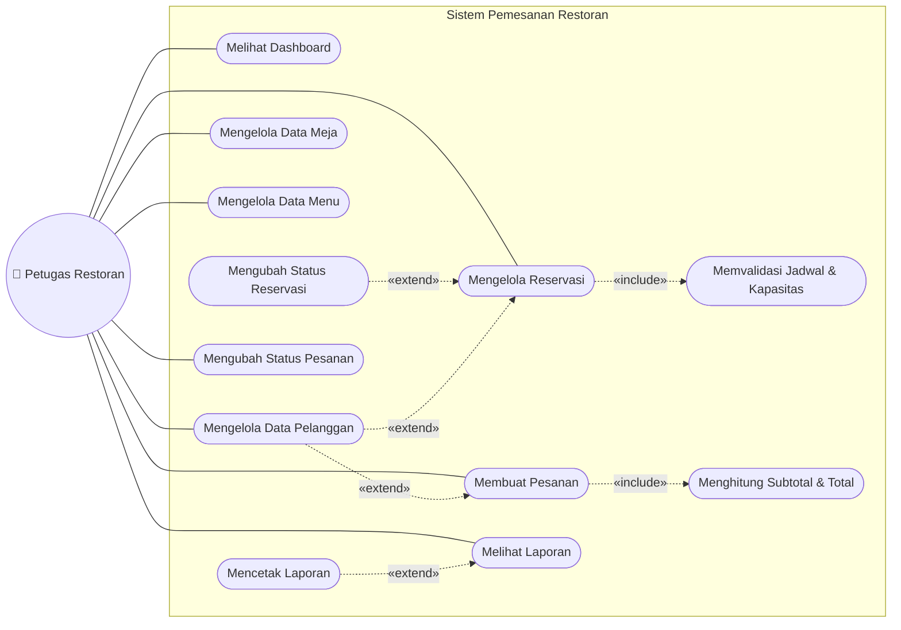
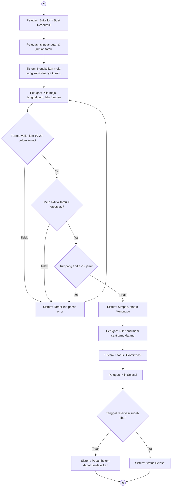
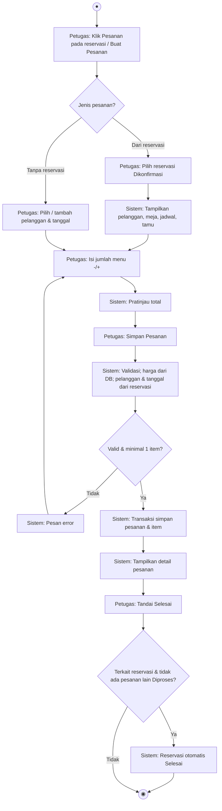
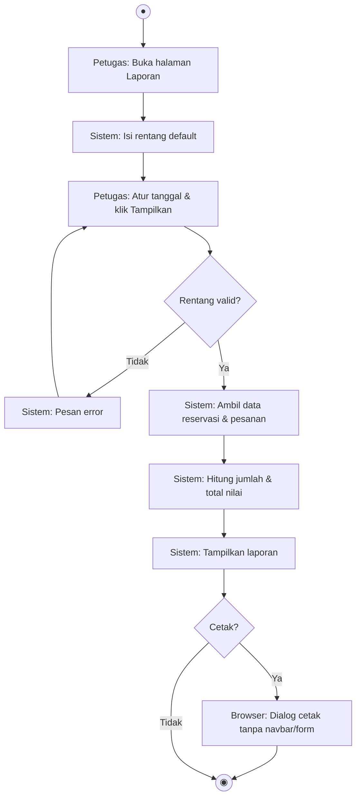
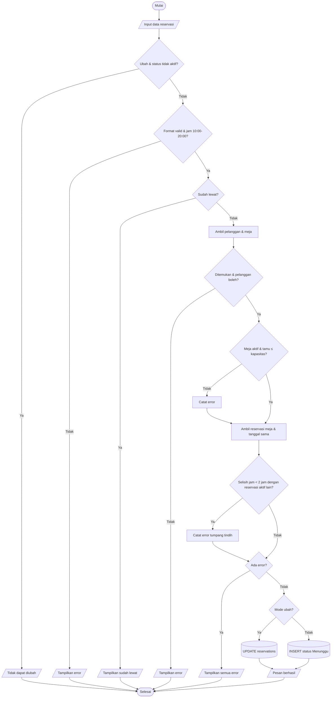
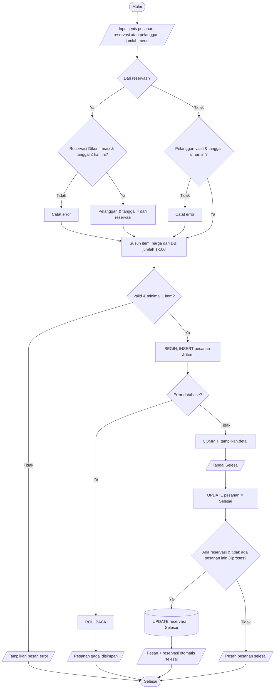
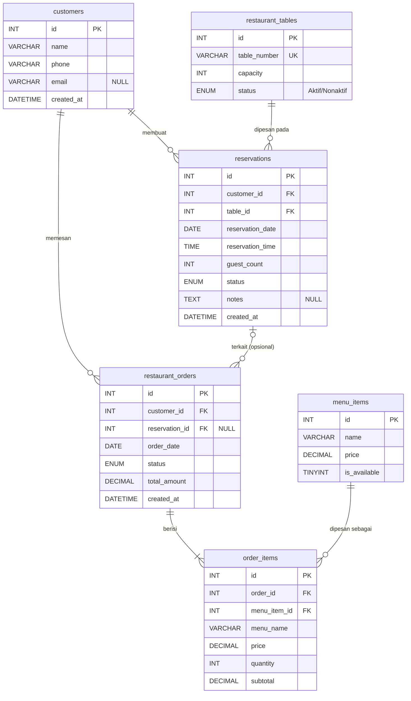

# Panduan Pembuatan Laporan DOCX & Diagram draw.io — Sistem Pemesanan Restoran

> Dokumen ini adalah **brief lengkap** untuk Claude (atau pembuat dokumen lain) yang akan membuat:
> 1. **Laporan Pengembangan dalam format `.docx`**, dan
> 2. **Diagram dalam format draw.io (`.drawio`)**: Use Case, Activity, Flowchart, dan ERD, beserta ekspor gambarnya untuk disisipkan ke DOCX.
>
> Semua informasi proyek yang dibutuhkan ada di dokumen ini. Pembuat **tidak perlu** dan **tidak bisa** mengakses kode sumber. Jangan menambah fitur, angka, atau hasil pengujian yang tidak tertulis di sini.

---

## Daftar Isi Panduan

0. [Instruksi untuk Pembuat Dokumen](#0-instruksi-untuk-pembuat-dokumen)
1. [Ringkasan Proyek](#1-ringkasan-proyek)
2. [Fitur dan Aturan Bisnis](#2-fitur-dan-aturan-bisnis)
3. [Struktur Proyek dan Kode](#3-struktur-proyek-dan-kode)
4. [Desain Database Lengkap](#4-desain-database-lengkap)
5. [Spesifikasi Diagram](#5-spesifikasi-diagram)
6. [Struktur DOCX Bab demi Bab](#6-struktur-docx-bab-demi-bab)
7. [Data Pengujian dan Debugging (Data Asli)](#7-data-pengujian-dan-debugging-data-asli)
8. [Format dan Gaya DOCX](#8-format-dan-gaya-docx)
9. [Gambaran Hasil Akhir](#9-gambaran-hasil-akhir)
10. [Checklist Penerimaan](#10-checklist-penerimaan)

---

## 0. Instruksi untuk Pembuat Dokumen

**Peran:** Anda adalah penulis dokumentasi teknis yang menyusun laporan pengembangan untuk uji kompetensi **Sertifikasi LSP Programmer** (skema Programmer, BNSP). Pembaca laporan adalah asesor yang menilai kompetensi pemrograman.

**Output yang diminta:**

| No | File | Keterangan |
|---|---|---|
| 1 | `Laporan-Pengembangan-Sistem-Pemesanan-Restoran.docx` | Laporan utama (struktur di Bagian 6, gaya di Bagian 8). |
| 2 | `01-use-case.drawio` | Use Case Diagram (Bagian 5.1). |
| 3 | `02-activity-reservasi.drawio` | Activity Diagram membuat/mengubah reservasi (Bagian 5.2.1). |
| 4 | `03-activity-pesanan.drawio` | Activity Diagram membuat pesanan (Bagian 5.2.2). |
| 5 | `04-activity-laporan.drawio` | Activity Diagram melihat & mencetak laporan (Bagian 5.2.3). |
| 6 | `05-flowchart-alur-umum.drawio` | Flowchart alur umum aplikasi (Bagian 5.3.1). |
| 7 | `06-flowchart-reservasi.drawio` | Flowchart validasi & simpan reservasi (Bagian 5.3.2). |
| 8 | `07-flowchart-pesanan.drawio` | Flowchart simpan pesanan dengan transaksi (Bagian 5.3.3). |
| 9 | `08-erd.drawio` | ERD / desain database (Bagian 5.4). |
| 10 | `01-use-case.png` … `08-erd.png` | Ekspor PNG setiap diagram (skala 2×, latar putih) untuk disisipkan ke DOCX. |

**Input tambahan dari user:** 16 tangkapan layar aplikasi dari folder `docs/screenshots/` (`01-dashboard.png` … `16-unit-test.png`, daftar lengkap di Bab V). Gunakan file tersebut apa adanya; jangan membuat tangkapan layar tiruan.

Sebagai alternatif dari file 2–9, boleh dibuat **satu file `diagram-sistem-restoran.drawio` multi-halaman** (satu tab per diagram, nama tab sama dengan nama file di atas).

**Aturan wajib:**

1. **Jangan mengarang.** Hasil unit test, uji end-to-end, dan kasus debugging di Bagian 7 adalah data asli. Salin apa adanya.
2. **Konsisten dengan implementasi.** Nama tabel, kolom, status, dan aturan validasi harus sama persis dengan Bagian 2 dan 4.
3. **Bahasa Indonesia** yang baku dan ringkas. Istilah teknis (PDO, prepared statement, foreign key) boleh tetap dalam bahasa Inggris dan dicetak miring bila perlu.
4. **Identitas peserta memakai placeholder**: `[Nama Peserta]`, `[No. Peserta]`, `[Tanggal Uji]`, `[Nama Asesor]`. Jangan diisi nama karangan.
5. **Tidak terlalu kompleks.** Laporan sekitar **20–30 halaman** termasuk gambar. Diagram rapi dan mudah dibaca, tanpa elemen yang tidak ada di aplikasi.
6. Diagram di DOCX harus **sama persis** dengan file `.drawio` (gambar diekspor dari file tersebut).
7. Sertakan **file `.drawio` yang dapat dibuka** di <https://app.diagrams.net> (format XML `mxfile`, tidak terkompresi lebih disarankan agar bisa diperiksa).

---

## 1. Ringkasan Proyek

| Item | Keterangan |
|---|---|
| Nama aplikasi | **Sistem Pemesanan Restoran** (nama brand di navbar: "Restoran Kita") |
| Jenis | Aplikasi web sederhana, dijalankan lokal (XAMPP / Laragon) |
| Tujuan | Mencatat pelanggan, meja, menu, reservasi meja, pesanan menu, dan menampilkan laporan yang dapat dicetak |
| Konteks | Tugas praktik demonstrasi Sertifikasi LSP Programmer |
| Pengguna (aktor) | **Petugas Restoran** (satu jenis pengguna; aplikasi **tanpa login** sesuai spesifikasi) |
| Bahasa antarmuka | Indonesia |
| Repositori | `Fuentes771/LSP-Programming` (GitHub) |

**Latar belakang singkat:** pencatatan reservasi dan pesanan secara manual rawan kesalahan, misalnya meja terpesan dua kali pada jam yang tumpang tindih, reservasi di luar jam buka, jumlah tamu melebihi kapasitas meja, atau total pesanan salah hitung. Aplikasi ini mencegah kesalahan tersebut lewat validasi di server dan perhitungan otomatis.

### Teknologi

| Teknologi | Versi / Keterangan | Kegunaan |
|---|---|---|
| PHP Native | 8.1+ (diuji dengan PHP 8.3.6 CLI) | Bahasa sisi server, tanpa framework |
| MySQL / MariaDB | MySQL 5.7+ / MariaDB 10.3+ (diuji dengan MariaDB 10.11.14) | Basis data relasional (InnoDB, utf8mb4) |
| PDO (`pdo_mysql`) | bawaan PHP | Koneksi database, *prepared statement*, transaksi |
| Bootstrap | 5.3.3 via CDN jsDelivr | Komponen UI: navbar, grid, card, table, form, input group, nav pills, alert, badge, button |
| Bootstrap Icons | 1.11.3 via CDN jsDelivr | Ikon di navigasi, tombol, kartu, dan badge status |
| HTML, CSS, JavaScript | seperlunya (`assets/`) | Struktur halaman, tema warna, gaya cetak (`@media print`), interaksi form |
| PHP CLI | — | Menjalankan unit test `php tests/test_functions.php` |
| XAMPP / Laragon | — | Lingkungan server lokal (Apache + PHP + MySQL) |

Yang **tidak** dipakai (sesuai batasan spesifikasi): Laravel, React, Docker, REST API, login/hak akses, pembayaran online, ekspor PDF/Excel.

---

## 2. Fitur dan Aturan Bisnis

### 2.1 Daftar Fitur

| Kode | Fitur | Rincian |
|---|---|---|
| F1 | Dashboard | Kartu total pelanggan, meja, reservasi, pesanan; kartu **reservasi hari ini**, **pesanan diproses**, **pendapatan hari ini**; tabel reservasi hari ini; tombol cepat Buat Reservasi & Buat Pesanan. |
| F2 | Data Pelanggan | Lihat, **cari** (nama/telepon), tambah, ubah, hapus. Data: nama, nomor telepon (**unik**), email (boleh kosong). Pelanggan baru juga bisa ditambahkan langsung dari form reservasi/pesanan. Tabel menampilkan jumlah reservasi & pesanan per pelanggan. |
| F3 | Data Meja | Lihat, **cari**, tambah, ubah, hapus. Data: nomor meja (unik), kapasitas, status **Aktif/Nonaktif**. Tabel menampilkan jumlah reservasi aktif mendatang. |
| F4 | Data Menu | Lihat, **cari**, tambah, ubah, hapus. Data: nama menu, harga, status **Tersedia/Tidak Tersedia**. |
| F5 | Reservasi Meja | Halaman **daftar** (filter **Hari Ini / Akan Datang / Semua** + filter status, tombol aksi sesuai status) dan halaman **form** terpisah untuk buat/ubah. Data: pelanggan, jumlah tamu, meja, tanggal, jam mulai, catatan (opsional). Status diubah lewat tombol **Konfirmasi**, **Selesai**, **Batalkan**. |
| F6 | Pesanan | Dua jenis: **Dari reservasi** (pilih reservasi Dikonfirmasi; pelanggan, meja, jadwal, dan tamu otomatis tampil, tinggal pilih menu) atau **Tanpa reservasi/walk-in** (pelanggan terdaftar/baru + tanggal). Menu dipilih dengan tombol −/+ dan ada **pratinjau subtotal & total**. Bisa dibuka langsung dari tombol **Pesanan** di daftar reservasi. Pesanan terakhir yang diselesaikan otomatis menyelesaikan reservasinya. Daftar dengan filter status, halaman detail dengan tombol **Tandai Selesai**/**Batalkan Pesanan** dan **Cetak**. |
| F7 | Laporan | Laporan reservasi dan pesanan berdasarkan rentang tanggal (pintasan Hari Ini, 7 Hari, Bulan Ini, Bulan Lalu), ringkasan jumlah & total nilai, tombol **Cetak** (fitur cetak browser). |

### 2.2 Status dan Alur Status

| Entitas | Nilai status | Catatan |
|---|---|---|
| Meja | `Aktif`, `Nonaktif` | Meja Nonaktif tidak muncul di pilihan reservasi. |
| Menu | `1` = Tersedia, `0` = Tidak Tersedia | Menu tidak tersedia tidak bisa dipesan. |
| Reservasi | `Menunggu`, `Dikonfirmasi`, `Selesai`, `Dibatalkan` | **Reservasi aktif** = `Menunggu` atau `Dikonfirmasi`. Reservasi baru **selalu** `Menunggu`. |
| Pesanan | `Diproses`, `Selesai`, `Dibatalkan` | Pesanan baru selalu `Diproses`. |

**Alur status (perpindahan yang diizinkan):**

```text
Reservasi:  Menunggu ──► Dikonfirmasi ──► Selesai
                │              │
                └──────────────┴──► Dibatalkan        (Selesai & Dibatalkan = final)

Pesanan:    Diproses ──► Selesai
                └──────► Dibatalkan                   (Selesai & Dibatalkan = final)
```

Makna status reservasi: **Menunggu** = baru dicatat; **Dikonfirmasi** = reservasi dipastikan/tamu datang (baru boleh dibuatkan pesanan); **Selesai** = tamu sudah selesai (otomatis saat pesanan terakhirnya selesai, atau manual jika tidak ada pesanan yang masih Diproses); **Dibatalkan** = batal.

**Keterkaitan reservasi ↔ pesanan:**

```text
Reservasi Menunggu ──Konfirmasi──► Dikonfirmasi ──Buat pesanan (pilih reservasi)──► Pesanan Diproses
                                                                                     │ Tandai Selesai
Reservasi Selesai ◄──otomatis jika tidak ada pesanan lain yang Diproses──────────── Pesanan Selesai
``` Alur disimpan sebagai konstanta `RESERVATION_TRANSITIONS` dan `ORDER_TRANSITIONS`, lalu diperiksa dengan fungsi `canChangeStatus()`.

Warna badge status di UI (dengan ikon): Aktif/Selesai = hijau, Menunggu/Diproses = kuning, Dikonfirmasi = biru muda, Dibatalkan = merah, Nonaktif = abu-abu.

### 2.3 Aturan Validasi (semua dilakukan di server)

**Aturan operasional (konstanta di `includes/functions.php`):**

| Konstanta | Nilai | Arti |
|---|---|---|
| `OPENING_TIME` | 10:00 | Jam buka restoran |
| `CLOSING_TIME` | 22:00 | Jam tutup restoran |
| `RESERVATION_DURATION_MINUTES` | 120 | Setiap reservasi memakai meja selama 2 jam |
| (turunan) jam mulai terakhir | 20:00 | 22:00 − 2 jam |
| `MAX_ORDER_QUANTITY` | 100 | Batas jumlah per menu dalam satu pesanan |

Zona waktu aplikasi: **Asia/Jakarta** (untuk menentukan "hari ini" dan jam yang sudah lewat).

**Pelanggan**
- Nama wajib diisi, maksimal 100 karakter.
- Nomor telepon 8–15 digit angka, boleh diawali `+`, dan **unik**: *"Nomor telepon 082345678901 sudah terdaftar atas nama Siti Aminah."*
- Email boleh kosong; jika diisi harus berformat email valid.

**Meja**
- Nomor meja wajib, maksimal 10 karakter, **unik** (duplikat ditolak: *"Nomor meja "M05" sudah digunakan."*).
- Kapasitas bilangan bulat > 0.
- Status harus `Aktif` atau `Nonaktif`.
- Meja **tidak bisa dinonaktifkan** jika masih punya reservasi aktif mulai hari ini: *"Meja tidak dapat dinonaktifkan karena masih memiliki reservasi aktif yang akan datang. ..."*

**Menu**
- Nama wajib, maksimal 100 karakter.
- Harga berupa angka **> 0** (nol/negatif/bukan angka ditolak).
- Status ketersediaan `0` atau `1`.

**Pelanggan baru langsung dari form reservasi/pesanan** (`includes/customer_picker.php`, `Customer::runWithCustomer()`)
- Form reservasi (mode buat) dan form pesanan punya tombol pilihan **Pelanggan terdaftar** / **Pelanggan baru**. Pelanggan baru diisi nama, telepon, email opsional.
- Pelanggan baru dibuat lebih dulu (validasi sama seperti halaman Pelanggan, pesan diberi awalan *"Pelanggan baru: "*), lalu reservasi/pesanan dibuat, **dalam satu transaksi**. Jika reservasi/pesanan gagal (validasi atau error database), pelanggan baru **ikut dibatalkan** dan form tetap terisi.
- `Order::create()` hanya memulai transaksi sendiri jika belum berada di dalam transaksi lain.
- Pesan sukses: *"... Pelanggan baru "Rina Kurnia" ditambahkan ke data Pelanggan."*
- Di form pesanan, memilih Pelanggan baru menonaktifkan pilihan reservasi (pelanggan baru belum punya reservasi).

**Membuat / mengubah reservasi** (`Reservation::create()` / `update()`)
1. Validasi format: pelanggan & meja dipilih, tanggal valid (`Y-m-d`, misalnya 2026-02-30 ditolak), jam valid, jumlah tamu bilangan bulat > 0.
2. **Jam operasional**: jam mulai 10:00–20:00, jika tidak: *"Waktu reservasi harus antara 10:00 dan 20:00 (restoran buka 10:00–22:00, durasi reservasi 2 jam)."*
3. **Tidak boleh di waktu yang sudah lewat**: *"Tanggal dan waktu reservasi sudah lewat."* Saat mengubah reservasi, aturan ini hanya diperiksa jika tanggal/jamnya diubah.
4. Pelanggan harus ada. Saat mengubah: pelanggan **tidak boleh diganti** jika reservasi sudah punya pesanan (selain yang Dibatalkan).
5. Meja harus ada dan **Aktif**: *"Meja M04 sedang Nonaktif dan tidak dapat direservasi."*
6. **Jumlah tamu ≤ kapasitas meja**: *"Jumlah tamu (5) melebihi kapasitas meja M02 (4 orang)."*
7. **Tidak boleh tumpang tindih**: tidak boleh ada reservasi aktif lain di meja dan tanggal yang sama dengan selisih jam mulai **kurang dari 2 jam**. Contoh: ada 19:00 → 17:30, 18:00, 20:30 ditolak; 17:00 dan 21:00 boleh (bersambung). Reservasi yang sedang diubah dikecualikan. Pesan: *"Meja M02 sudah dipesan pada rentang waktu tersebut. Setiap reservasi memakai meja selama 2 jam; pilih jam atau meja lain."*
8. Waktu dinormalisasi ke `HH:MM:SS` sebelum dibandingkan dan disimpan (form mengirim `19:00`, database mengembalikan `19:00:00`).
9. Pesan error langkah 5–7 dikumpulkan dan ditampilkan bersama. Form tetap terisi agar pengguna bisa memperbaiki.
10. Reservasi baru disimpan dengan status **Menunggu**. Form **tidak** memiliki pilihan status.
11. Hanya reservasi **aktif** (Menunggu/Dikonfirmasi) yang bisa diubah: *"Reservasi yang sudah Selesai tidak dapat diubah."*

**Bantuan di browser (form reservasi):** tanggal minimal hari ini, jam dibatasi 10:00–20:00 (kelipatan 15 menit), dan JavaScript otomatis menonaktifkan meja yang kapasitasnya kurang dari jumlah tamu (diberi label "— kapasitas kurang"). Semua tetap diperiksa ulang di server.

**Mengubah status reservasi** (`Reservation::changeStatus()`)
- Harus sesuai alur di Bagian 2.2, jika tidak: *"Status reservasi tidak dapat diubah dari Menunggu menjadi Selesai."*
- **Dikonfirmasi** tidak boleh untuk reservasi yang tanggalnya sudah lewat: *"Reservasi yang tanggalnya sudah lewat tidak dapat dikonfirmasi. Batalkan reservasi tersebut."* Di daftar, reservasi aktif bertanggal lewat diberi tanda *"Tanggal sudah lewat"*.
- **Selesai** tidak boleh sebelum tanggal reservasi: *"Reservasi belum dapat diselesaikan sebelum tanggal reservasinya."*
- **Selesai** manual ditolak selama masih ada pesanan Diproses: *"Reservasi belum dapat diselesaikan karena masih ada pesanan yang Diproses. Selesaikan pesanannya; reservasi akan ikut selesai otomatis."*
- **Dibatalkan** ditolak jika reservasi sudah punya pesanan (selain yang Dibatalkan): *"Reservasi tidak dapat dibatalkan karena sudah memiliki pesanan. Batalkan pesanannya terlebih dahulu."*
- Data reservasi tidak pernah dihapus. Slot meja dari reservasi yang dibatalkan dapat dipakai lagi.
- Setelah reservasi punya pesanan, **pelanggan dan tanggal** reservasi dikunci (*"Tanggal tidak dapat diubah karena reservasi ini sudah memiliki pesanan."*).
- Tombol di daftar mengikuti status: Menunggu → **Konfirmasi** (jika tanggal belum lewat), **Ubah**, **Batalkan**; Dikonfirmasi → **Pesanan** (jika tanggalnya sudah tiba), **Selesai** (jika tanggal sudah tiba dan tidak ada pesanan Diproses; jika ada, tampil keterangan *"Selesai otomatis saat pesanan selesai"*), **Ubah**, **Batalkan** (hanya jika belum ada pesanan); Selesai/Dibatalkan → tanpa tombol.

**Pesanan** (`Order::create()`)
1. Form diawali pilihan **jenis pesanan**: **Dari reservasi** (default jika ada reservasi yang siap) atau **Tanpa reservasi (walk-in)**.
2. **Dari reservasi**: wajib memilih reservasi. Reservasi harus ada, berstatus **Dikonfirmasi** (*"Pesanan hanya dapat dibuat untuk reservasi yang sudah Dikonfirmasi (status saat ini: Menunggu). Konfirmasi reservasinya terlebih dahulu."*), dan tanggalnya **sudah tiba** (*"Pesanan untuk reservasi baru dapat dibuat pada tanggal reservasinya."*). **Pelanggan dan tanggal pesanan diambil dari reservasi**; data pelanggan/tanggal yang dikirim form diabaikan. Meja ditampilkan dari reservasi.
3. **Tanpa reservasi (walk-in)**: pelanggan terdaftar wajib dipilih (atau tambah pelanggan baru), tanggal pesanan valid dan **tidak boleh melebihi hari ini**.
4. Item dibangun dari input jumlah per menu (`buildOrderItems()`):
   - jumlah kosong atau `0` berarti menu tidak dipesan,
   - jumlah harus bilangan bulat **1–100**,
   - hanya menu **tersedia** yang boleh dipesan,
   - minimal **satu** menu harus dipilih.
5. **Harga diambil dari database**, bukan dari form. Harga dan nama menu **disalin** ke `order_items`, sehingga perubahan harga menu di kemudian hari tidak mengubah pesanan lama.
6. `subtotal = harga × jumlah`; `total = Σ subtotal` (dibulatkan 2 desimal).
7. Penyimpanan dalam **satu transaksi**: `BEGIN` → INSERT `restaurant_orders` → INSERT setiap `order_items` → `COMMIT`. Jika terjadi error: `ROLLBACK`, pengguna melihat *"Pesanan gagal disimpan. Silakan coba lagi."*, dan detail error hanya dicatat ke log server.
8. Setelah tersimpan, pengguna diarahkan ke halaman **Detail Pesanan**.

**Bantuan di browser (form pesanan):** tombol jenis pesanan menampilkan bagian yang sesuai dan menonaktifkan bagian lain (`fieldset disabled`, sehingga isiannya tidak divalidasi/terkirim); dropdown reservasi berisi reservasi **Dikonfirmasi** 30 hari terakhir s.d. hari ini dengan teks "Nama · Meja · Tanggal Jam"; memilih reservasi langsung menampilkan kartu info **Pelanggan, Meja, Jadwal, Tamu**; tombol −/+ per menu; pratinjau subtotal per baris, jumlah item, dan total (total final dihitung ulang oleh server). Jika belum ada reservasi Dikonfirmasi, tampil peringatan dengan tautan ke halaman Reservasi.

**Mengubah status pesanan** (`Order::updateStatus()`): hanya **Diproses → Selesai** atau **Diproses → Dibatalkan**. Pesanan Selesai/Dibatalkan bersifat final; halaman detail tidak lagi menampilkan tombol ubah status (diganti keterangan "sudah final"). Jika pesanan yang terkait reservasi ditandai **Selesai** dan tidak ada pesanan lain untuk reservasi itu yang masih Diproses, reservasi **otomatis ikut Selesai** dalam transaksi yang sama (*"Pesanan ditandai selesai. Reservasi terkait otomatis ditandai selesai."*). Membatalkan pesanan tidak mengubah status reservasi.

**Laporan**
- Input: tanggal awal & akhir (default: tanggal 1 bulan berjalan s.d. hari ini), plus pintasan Hari Ini, 7 Hari, Bulan Ini, Bulan Lalu.
- Tanggal awal tidak boleh melebihi tanggal akhir.
- Laporan reservasi difilter berdasarkan `reservation_date`; laporan pesanan berdasarkan `order_date`.
- Ringkasan: **jumlah reservasi**, **jumlah pesanan**, **total nilai pesanan** (pesanan `Dibatalkan` **tidak dihitung**).
- Tombol **Cetak** memanggil `window.print()`; navbar, form filter, dan tombol disembunyikan saat dicetak.

**Proteksi hapus (relasi tidak boleh rusak)**

| Data | Ditolak jika | Pesan |
|---|---|---|
| Pelanggan | punya reservasi atau pesanan | "Pelanggan tidak dapat dihapus karena masih memiliki data reservasi atau pesanan." |
| Meja | punya reservasi | "Meja tidak dapat dihapus karena masih memiliki data reservasi. Ubah statusnya menjadi Nonaktif." |
| Menu | pernah dipesan | "Menu tidak dapat dihapus karena sudah pernah dipesan. Ubah statusnya menjadi Tidak Tersedia." |

Selain pengecekan di aplikasi, *foreign key* `ON DELETE RESTRICT` di database menjadi pengaman kedua (error SQLSTATE `23000` ditangkap dan diubah menjadi pesan ramah).

**Pesan umum:** setiap aksi menampilkan pesan berhasil (alert hijau, hilang otomatis setelah 5 detik) atau gagal (alert merah, tetap tampil). Pola **Post/Redirect/Get** dipakai agar form tidak terkirim ulang saat halaman di-refresh.

### 2.4 Keamanan Dasar

- Semua query yang menerima input memakai *prepared statement* PDO; tidak ada penggabungan string input ke SQL.
- Semua output di-*escape* dengan `htmlspecialchars` (fungsi `e()`) untuk mencegah XSS.
- Halaman yang boleh dibuka dibatasi dengan *whitelist* parameter `?page=`; nilai lain diarahkan ke dashboard.
- File halaman (`pages/*.php`) dan template tampilan tidak bisa diakses langsung.
- Aksi hapus/batal memakai form POST + konfirmasi JavaScript.
- Error database: pengguna hanya melihat pesan umum, sedangkan detail dicatat dengan `error_log()`. Password tidak pernah ditampilkan.

---

## 3. Struktur Proyek dan Kode

### 3.1 Struktur Folder

```text
LSP-Programming/
├── config/
│   └── database.php          # konstanta DB_HOST/DB_PORT/DB_NAME/DB_USER/DB_PASS + getConnection()
├── classes/
│   ├── BaseModel.php         # class abstrak induk
│   ├── Customer.php
│   ├── RestaurantTable.php
│   ├── MenuItem.php
│   ├── Reservation.php
│   └── Order.php
├── includes/
│   ├── functions.php         # fungsi validasi, perhitungan, helper tampilan
│   ├── customer_picker.php   # pilihan pelanggan terdaftar / pelanggan baru (form reservasi & pesanan)
│   ├── header.php            # <head>, Bootstrap CSS, flash message
│   ├── navbar.php            # navigasi
│   └── footer.php            # Bootstrap JS
├── pages/
│   ├── dashboard.php
│   ├── customers.php
│   ├── tables.php
│   ├── menu.php
│   ├── reservations.php      # mode: daftar (?scope=today|upcoming|all), buat/ubah (?action=create|edit)
│   ├── orders.php            # mode: daftar (?status=), buat (?action=create[&reservation_id=]), detail (?action=view&id=)
│   └── reports.php
├── assets/
│   ├── css/style.css         # tema warna restoran di atas Bootstrap
│   └── js/app.js             # filter meja & reservasi, kunci tanggal, pratinjau total
├── tests/
│   └── test_functions.php    # unit test CLI, output PASS/FAIL, exit code 0/1
├── docs/
│   ├── laporan.md            # laporan versi Markdown
│   └── presentasi.md         # outline 8 slide
├── database.sql              # pembuatan database restoran_db + data contoh
├── index.php                 # titik masuk: index.php?page=<nama>
└── README.md                 # cara instalasi & menjalankan
```

### 3.2 Arsitektur Singkat

```text
Browser ──► index.php?page=xxx ──► pages/xxx.php ──► classes/*.php ──► PDO ──► MySQL/MariaDB
               │                        │
               │                        ├─ includes/functions.php (validasi & perhitungan)
               │                        └─ includes/header.php, navbar.php, footer.php (tampilan)
               └─ session_start, whitelist halaman, tangkap PDOException
```

Alur sebuah halaman: (1) jika request POST, proses aksi → validasi → panggil method class → set pesan flash → redirect; (2) jika GET, ambil data dari class → render HTML dengan Bootstrap.

### 3.3 Class (OOP)

```text
                 ┌──────────────────────────────┐
                 │   «abstract» BaseModel       │
                 │ # db : PDO                   │
                 │ # table : string             │
                 │ + __construct(PDO db)        │
                 │ + count() : int              │
                 │ + find(int id) : ?array      │
                 │ # countRelated(...) : int    │
                 │ # isConstraintError(e): bool │
                 └──────────────┬───────────────┘
        ┌───────────┬───────────┼────────────┬──────────────┐
   Customer   RestaurantTable  MenuItem   Reservation      Order
```

| Class | Tabel | Method publik | Tanggung jawab |
|---|---|---|---|
| `BaseModel` (abstract) | — | `count()`, `find()` | Menyimpan koneksi PDO, method umum, cek relasi & constraint |
| `Customer` | `customers` | `all($search)`, `findByPhone()`, `save()`, `runWithCustomer()`, `delete()` | CRUD + pencarian pelanggan, telepon unik, pembuatan pelanggan baru bersama reservasi/pesanan dalam satu transaksi, cek relasi sebelum hapus |
| `RestaurantTable` | `restaurant_tables` | `all($search)`, `active()`, `save()`, `delete()` | CRUD meja, nomor unik, larang nonaktif jika ada reservasi mendatang |
| `MenuItem` | `menu_items` | `all($search)`, `available()`, `save()`, `delete()` | CRUD menu, daftar menu tersedia |
| `Reservation` | `reservations` | `all($scope, $status)`, `findWithRelations()`, `countOn()`, `forOrder()`, `between()`, `create()`, `update()`, `changeStatus()` | Aturan jam operasional, waktu lewat, kapasitas, tumpang tindih 2 jam, alur status, kunci pelanggan/tanggal setelah ada pesanan, laporan |
| `Order` | `restaurant_orders`, `order_items` | `all($status)`, `between()`, `countByStatus()`, `revenueOn()`, `findWithItems()`, `create()`, `updateStatus()` | Pelanggan/tanggal dari reservasi, simpan pesanan + item dalam transaksi, alur status, penyelesaian otomatis reservasi, laporan |

Konsep OOP yang ditunjukkan: **abstraksi** (class abstrak), **pewarisan** (`extends BaseModel`), **enkapsulasi** (property `protected`; property `$now` dan method `private` seperti `persist()`, `onTableAndDate()`, `countActiveOrders()`), dan ***dependency injection*** (PDO lewat constructor; `Reservation`/`Order` bisa menerima waktu "sekarang" lewat constructor; `Order::create()` menerima objek `MenuItem`).

### 3.4 Fungsi (Pemrograman Terstruktur) — `includes/functions.php`

| Kelompok | Fungsi |
|---|---|
| Konstanta | `TABLE_STATUSES`, `RESERVATION_STATUSES`, `ACTIVE_RESERVATION_STATUSES`, `ORDERABLE_RESERVATION_STATUSES`, `ORDER_STATUSES`, `RESERVATION_TRANSITIONS`, `ORDER_TRANSITIONS`, `OPENING_TIME`, `CLOSING_TIME`, `RESERVATION_DURATION_MINUTES`, `MAX_ORDER_QUANTITY` |
| Perhitungan | `calculateSubtotal($price, $qty)`, `calculateOrderTotal($items)`, `buildOrderItems($quantities, $menus)` |
| Validasi dasar | `isRequired()`, `isValidEmail()`, `isValidPhone()`, `isValidDate()`, `isValidTime()`, `normalizeTime()`, `timeToMinutes()`, `isPositiveInteger()`, `validatePrice()`, `validateQuantity()`, `validateCapacity()`, `validateGuestCount()`, `validateOrderDate()` |
| Aturan waktu reservasi | `latestReservationStart()`, `isWithinOperatingHours($time)`, `isPastDateTime($date, $time, $now)` |
| Aturan bisnis | `hasReservationConflict($existing, $tableId, $date, $time, $excludeId)`, `canChangeStatus($from, $to, $transitions)`, `validateReservationForOrder($reservation, $today)`, `shouldCompleteReservation($reservationStatus, $openOrderCount)` |
| Validasi entitas | `validateCustomerData()`, `validateTableData()`, `validateMenuData()`, `validateReservationData($data, $now, $checkPast)`, `validateDateRange()` (mengembalikan daftar pesan error) |
| Helper tampilan | `e()`, `formatRupiah()`, `formatDate()`, `formatTime()`, `statusBadgeClass()`, `statusBadge()`, `pageHeader()`, `emptyState()`, `setFlash()`, `getFlash()`, `flashResult()`, `redirect()`, `pageUrl()`, `showErrors()`, `actionButton()`, `input()`, `query()` |

Fungsi-fungsi ini **tidak mengakses database**, sehingga bisa diuji langsung dari terminal. Fungsi yang bergantung pada waktu menerima "sekarang" sebagai parameter agar hasil test tidak berubah-ubah.

### 3.5 Cuplikan Kode Kunci (boleh dikutip di DOCX)

```php
function calculateSubtotal($price, $quantity): float
{
    return round((float) $price * (int) $quantity, 2);
}

function calculateOrderTotal(array $items): float
{
    $total = 0.0;
    foreach ($items as $item) {
        $total += calculateSubtotal($item['price'], $item['quantity']);
    }
    return round($total, 2);
}

/** Jumlah tamu minimal 1 dan tidak boleh melebihi kapasitas meja. */
function validateGuestCount($guestCount, $capacity): bool
{
    return isPositiveInteger($guestCount) && (int) $guestCount <= (int) $capacity;
}
```

```php
function isWithinOperatingHours(string $time): bool
{
    $start = timeToMinutes($time);
    return $start >= timeToMinutes(OPENING_TIME)
        && $start + RESERVATION_DURATION_MINUTES <= timeToMinutes(CLOSING_TIME);
}

function hasReservationConflict(array $existing, int $tableId, string $date, string $time, ?int $excludeId = null): bool
{
    $start = timeToMinutes(normalizeTime($time));
    foreach ($existing as $reservation) {
        if ($excludeId !== null && (int) $reservation['id'] === $excludeId) {
            continue;
        }
        if ((int) $reservation['table_id'] === $tableId
            && $reservation['reservation_date'] === $date
            && in_array($reservation['status'], ACTIVE_RESERVATION_STATUSES, true)
            && abs(timeToMinutes(normalizeTime($reservation['reservation_time'])) - $start) < RESERVATION_DURATION_MINUTES) {
            return true;
        }
    }
    return false;
}

function canChangeStatus(string $from, string $to, array $transitions): bool
{
    return in_array($to, $transitions[$from] ?? [], true);
}
```

```php
// Order::create() — transaksi (diringkas)
try {
    $this->db->beginTransaction();
    // INSERT INTO restaurant_orders (...) VALUES (?, ?, ?, 'Diproses', ?)
    $orderId = (int) $this->db->lastInsertId();
    // INSERT INTO order_items (...) VALUES (?, ?, ?, ?, ?, ?)  -- untuk setiap item
    $this->db->commit();
} catch (PDOException $e) {
    if ($this->db->inTransaction()) {
        $this->db->rollBack();   // tidak ada data tersimpan setengah
    }
    error_log('Gagal menyimpan pesanan: ' . $e->getMessage());
    return ['errors' => ['Pesanan gagal disimpan. Silakan coba lagi.'], 'id' => null];
}
```

```php
// config/database.php — koneksi PDO (diringkas)
$pdo = new PDO($dsn, DB_USER, DB_PASS, [
    PDO::ATTR_ERRMODE            => PDO::ERRMODE_EXCEPTION,
    PDO::ATTR_DEFAULT_FETCH_MODE => PDO::FETCH_ASSOC,
    PDO::ATTR_EMULATE_PREPARES   => false,
]);
```

---

## 4. Desain Database Lengkap

Nama database: **`restoran_db`**, engine **InnoDB**, charset **utf8mb4** (`utf8mb4_unicode_ci`). Jumlah tabel: **6**.

### 4.1 Kamus Data

**Tabel `customers`**: data pelanggan

| Kolom | Tipe | Null | Default | Key | Keterangan |
|---|---|---|---|---|---|
| id | INT UNSIGNED AUTO_INCREMENT | Tidak | — | PK | ID pelanggan |
| name | VARCHAR(100) | Tidak | — | | Nama pelanggan |
| phone | VARCHAR(20) | Tidak | — | | Nomor telepon (8–15 digit) |
| email | VARCHAR(100) | Ya | NULL | | Email (opsional) |
| created_at | DATETIME | Tidak | CURRENT_TIMESTAMP | | Waktu data dibuat |

**Tabel `restaurant_tables`**: data meja

| Kolom | Tipe | Null | Default | Key | Keterangan |
|---|---|---|---|---|---|
| id | INT UNSIGNED AUTO_INCREMENT | Tidak | — | PK | ID meja |
| table_number | VARCHAR(10) | Tidak | — | UNIQUE | Nomor meja, misalnya M01 |
| capacity | INT UNSIGNED | Tidak | — | | Kapasitas (orang) |
| status | ENUM('Aktif','Nonaktif') | Tidak | 'Aktif' | | Status meja |

**Tabel `menu_items`**: data menu

| Kolom | Tipe | Null | Default | Key | Keterangan |
|---|---|---|---|---|---|
| id | INT UNSIGNED AUTO_INCREMENT | Tidak | — | PK | ID menu |
| name | VARCHAR(100) | Tidak | — | | Nama menu |
| price | DECIMAL(12,2) | Tidak | — | | Harga saat ini |
| is_available | TINYINT(1) | Tidak | 1 | | 1 = tersedia, 0 = tidak tersedia |

**Tabel `reservations`**: reservasi meja

| Kolom | Tipe | Null | Default | Key | Keterangan |
|---|---|---|---|---|---|
| id | INT UNSIGNED AUTO_INCREMENT | Tidak | — | PK | ID reservasi |
| customer_id | INT UNSIGNED | Tidak | — | FK → customers.id | Pelanggan |
| table_id | INT UNSIGNED | Tidak | — | FK → restaurant_tables.id | Meja |
| reservation_date | DATE | Tidak | — | INDEX* | Tanggal reservasi |
| reservation_time | TIME | Tidak | — | INDEX* | Waktu reservasi |
| guest_count | INT UNSIGNED | Tidak | — | | Jumlah tamu |
| status | ENUM('Menunggu','Dikonfirmasi','Selesai','Dibatalkan') | Tidak | 'Menunggu' | | Status reservasi |
| notes | TEXT | Ya | NULL | | Catatan (opsional) |
| created_at | DATETIME | Tidak | CURRENT_TIMESTAMP | | Waktu data dibuat |

\* Index gabungan `idx_reservation_slot (table_id, reservation_date, reservation_time)` untuk mempercepat pengecekan bentrok.

**Tabel `restaurant_orders`**: header pesanan

| Kolom | Tipe | Null | Default | Key | Keterangan |
|---|---|---|---|---|---|
| id | INT UNSIGNED AUTO_INCREMENT | Tidak | — | PK | ID / nomor pesanan |
| customer_id | INT UNSIGNED | Tidak | — | FK → customers.id | Pelanggan |
| reservation_id | INT UNSIGNED | **Ya** | NULL | FK → reservations.id | Reservasi terkait (opsional) |
| order_date | DATE | Tidak | — | | Tanggal pesanan |
| status | ENUM('Diproses','Selesai','Dibatalkan') | Tidak | 'Diproses' | | Status pesanan |
| total_amount | DECIMAL(12,2) | Tidak | 0 | | Total = Σ subtotal item |
| created_at | DATETIME | Tidak | CURRENT_TIMESTAMP | | Waktu data dibuat |

**Tabel `order_items`**: detail item pesanan

| Kolom | Tipe | Null | Default | Key | Keterangan |
|---|---|---|---|---|---|
| id | INT UNSIGNED AUTO_INCREMENT | Tidak | — | PK | ID item |
| order_id | INT UNSIGNED | Tidak | — | FK → restaurant_orders.id | Pesanan induk |
| menu_item_id | INT UNSIGNED | Tidak | — | FK → menu_items.id | Menu yang dipesan |
| menu_name | VARCHAR(100) | Tidak | — | | **Salinan** nama menu saat dipesan |
| price | DECIMAL(12,2) | Tidak | — | | **Salinan** harga saat dipesan |
| quantity | INT UNSIGNED | Tidak | — | | Jumlah |
| subtotal | DECIMAL(12,2) | Tidak | — | | price × quantity |

### 4.2 Relasi

| No | Relasi | Kardinalitas | Foreign key | ON DELETE | ON UPDATE |
|---|---|---|---|---|---|
| R1 | customers → reservations | 1 : 0..N | reservations.customer_id | RESTRICT | CASCADE |
| R2 | restaurant_tables → reservations | 1 : 0..N | reservations.table_id | RESTRICT | CASCADE |
| R3 | customers → restaurant_orders | 1 : 0..N | restaurant_orders.customer_id | RESTRICT | CASCADE |
| R4 | reservations → restaurant_orders | 0..1 : 0..N (opsional) | restaurant_orders.reservation_id (NULL) | RESTRICT | CASCADE |
| R5 | restaurant_orders → order_items | 1 : 1..N* | order_items.order_id | **CASCADE** | CASCADE |
| R6 | menu_items → order_items | 1 : 0..N | order_items.menu_item_id | RESTRICT | CASCADE |

\* Minimal satu item dijamin oleh aplikasi (`buildOrderItems()`), bukan oleh constraint database.

**Catatan desain yang perlu dijelaskan di laporan:**
- Harga & total memakai `DECIMAL(12,2)` (bukan teks/float) agar perhitungan uang tepat.
- `order_items.menu_name` dan `order_items.price` adalah salinan (*snapshot*) agar pesanan lama tidak berubah saat harga menu diubah.
- `RESTRICT` mencegah data induk yang masih dipakai ikut terhapus. `CASCADE` hanya pada `order_items.order_id` karena item tidak bermakna tanpa pesanannya.
- `restaurant_orders.reservation_id` boleh NULL karena pesanan bisa tanpa reservasi.

### 4.3 Data Contoh (dari `database.sql`)

| Tabel | Data |
|---|---|
| customers | Budi Santoso (081234567890, budi@example.com), Siti Aminah (082345678901, tanpa email), Andi Wijaya (083456789012, andi@example.com) |
| restaurant_tables | M01 (2 orang, Aktif), M02 (4, Aktif), M03 (6, Aktif), M04 (8, Nonaktif) |
| menu_items | Nasi Goreng Spesial Rp25.000, Mie Ayam Bakso Rp20.000, Ayam Bakar Rp30.000, Es Teh Manis Rp5.000, Jus Alpukat Rp15.000 (tidak tersedia) |
| reservations | (tanggal relatif `CURDATE()`) #1 Budi, M02, kemarin 19:00, 3 tamu, Selesai · #2 Budi, M02, hari ini 12:00, 4 tamu, Dikonfirmasi, "Makan siang kantor" · #3 Andi, M03, hari ini 19:00, 5 tamu, Menunggu, "Ulang tahun" · #4 Siti, M01, besok 18:30, 2 tamu, Menunggu |
| restaurant_orders | #1 Budi (reservasi #1), kemarin, Selesai, Rp60.000 · #2 Budi (reservasi #2), hari ini, Diproses, Rp95.000 · #3 Siti (tanpa reservasi), hari ini, Selesai, Rp25.000 |
| order_items | #1: Nasi Goreng ×2, Es Teh ×2 · #2: Ayam Bakar ×2, Mie Ayam ×1, Es Teh ×3 · #3: Mie Ayam ×1, Es Teh ×1 |

---

## 5. Spesifikasi Diagram

### 5.0 Konvensi Umum draw.io

| Aspek | Ketentuan |
|---|---|
| Format file | `.drawio` (XML `mxfile`), bisa dibuka di app.diagrams.net |
| Halaman | Satu diagram per file (atau satu tab per diagram bila memakai satu file) |
| Font | Helvetica/Arial 12 pt untuk isi, 14 pt tebal untuk judul/nama entitas |
| Warna | Netral dan konsisten: isi putih atau biru muda (`#DAE8FC`, garis `#6C8EBF`) untuk proses/use case, kuning muda (`#FFF2CC`, garis `#D6B656`) untuk keputusan, hijau muda (`#D5E8D4`, garis `#82B366`) untuk mulai/selesai flowchart, abu-abu muda (`#F5F5F5`) untuk header tabel ERD |
| Garis | Hitam/abu tua, 1 pt; garis siku (*orthogonal*) untuk activity, flowchart, ERD |
| Label | Bahasa Indonesia; label cabang keputusan **"Ya"/"Tidak"** |
| Ekspor | PNG, skala **2×**, latar **putih**, border 10 px, nama file sama dengan `.drawio` |
| Ukuran | Muat di halaman A4 portrait (lebar gambar di DOCX ±15–16 cm). Jika diagram tinggi, maksimal 1 halaman per gambar. |

**Style draw.io yang disarankan:**

| Elemen | Style |
|---|---|
| Aktor | `shape=umlActor;verticalLabelPosition=bottom;verticalAlign=top;html=1;` |
| Use case | `ellipse;whiteSpace=wrap;html=1;fillColor=#dae8fc;strokeColor=#6c8ebf;` |
| Batas sistem | `rounded=0;whiteSpace=wrap;html=1;fillColor=none;verticalAlign=top;fontStyle=1;` |
| Asosiasi | `endArrow=none;html=1;` |
| Include/Extend | `endArrow=open;dashed=1;html=1;` dengan label `«include»` / `«extend»` |
| Start (activity) | `ellipse;fillColor=#000000;strokeColor=#000000;` (lingkaran hitam 30×30) |
| End (activity) | `ellipse;html=1;shape=endState;fillColor=#000000;strokeColor=#000000;` |
| Aksi (activity) | `rounded=1;whiteSpace=wrap;html=1;arcSize=40;fillColor=#dae8fc;strokeColor=#6c8ebf;` |
| Keputusan | `rhombus;whiteSpace=wrap;html=1;fillColor=#fff2cc;strokeColor=#d6b656;` |
| Swimlane | `swimlane;html=1;startSize=30;horizontal=1;` (2 lajur berdampingan: Petugas, Sistem) |
| Terminator (flowchart) | `rounded=1;whiteSpace=wrap;html=1;arcSize=50;fillColor=#d5e8d4;strokeColor=#82b366;` |
| Proses (flowchart) | `rounded=0;whiteSpace=wrap;html=1;` |
| Input/Output | `shape=parallelogram;perimeter=parallelogramPerimeter;whiteSpace=wrap;html=1;fixedSize=1;` |
| Database | `shape=cylinder3;whiteSpace=wrap;html=1;boundedLbl=1;size=10;` |
| Entitas ERD | `shape=table;startSize=30;container=1;collapsible=0;childLayout=tableLayout;fixedRows=1;rowLines=0;fontStyle=1;align=center;` (atau "Entity Relation → Table" dari pustaka draw.io) |
| Relasi ERD | `edgeStyle=entityRelationEdgeStyle;endArrow=ERmany;startArrow=ERmandOne;html=1;` (sesuaikan: `ERzeroToMany`, `ERoneToMany`, `ERzeroToOne`) |

> Blok **Mermaid** di bawah hanya **sketsa gambaran** isi dan alur. Hasil akhir dibuat di draw.io sesuai notasi UML/flowchart standar, bukan screenshot Mermaid.

---

### 5.1 Use Case Diagram — `01-use-case.drawio`

**Tujuan:** menggambarkan interaksi aktor dengan fungsi-fungsi sistem.

**Elemen:**
- **Aktor:** `Petugas Restoran` (kiri, di luar batas sistem).
- **Batas sistem:** persegi berlabel `Sistem Pemesanan Restoran`.
- **Use case (12):**

| Kode | Use case | Hubungan |
|---|---|---|
| UC-01 | Melihat Dashboard | asosiasi dengan aktor |
| UC-02 | Mengelola Data Pelanggan | asosiasi; UC-02 `«extend»` UC-05 dan UC-08 (tambah pelanggan baru dari form) |
| UC-03 | Mengelola Data Meja | asosiasi |
| UC-04 | Mengelola Data Menu | asosiasi |
| UC-05 | Mengelola Reservasi | asosiasi |
| UC-06 | Memvalidasi Jadwal & Kapasitas | UC-05 `«include»` UC-06 |
| UC-07 | Mengubah Status Reservasi (Konfirmasi/Selesai/Batal) | UC-07 `«extend»` UC-05 |
| UC-08 | Membuat Pesanan | asosiasi |
| UC-09 | Menghitung Subtotal & Total | UC-08 `«include»` UC-09 |
| UC-10 | Mengubah Status Pesanan | asosiasi |
| UC-11 | Melihat Laporan | asosiasi |
| UC-12 | Mencetak Laporan | UC-12 `«extend»` UC-11 |

Arah panah: `«include»` dari use case dasar **ke** use case yang di-include; `«extend»` dari use case perluasan **ke** use case dasar.

**Tata letak:** aktor di kiri tengah. Use case utama (UC-01…05, 08, 10, 11) tersusun vertikal di kolom kiri batas sistem; use case include/extend (UC-06, 07, 09, 12) di kolom kanan sejajar dengan use case dasarnya.



**Tabel deskripsi use case (untuk DOCX):**

| Kode | Nama | Deskripsi singkat | Kondisi akhir |
|---|---|---|---|
| UC-01 | Melihat Dashboard | Petugas melihat total data, reservasi hari ini, pesanan diproses, dan pendapatan hari ini. | Ringkasan tampil. |
| UC-02 | Mengelola Data Pelanggan | Menambah, mengubah, menghapus, mencari, dan melihat pelanggan. | Data tersimpan/terhapus; hapus ditolak bila berelasi. |
| UC-03 | Mengelola Data Meja | Menambah, mengubah, menghapus, mencari, dan melihat meja beserta kapasitas & status. | Data tersimpan; nomor meja unik; tidak bisa dinonaktifkan jika ada reservasi mendatang. |
| UC-04 | Mengelola Data Menu | Menambah, mengubah, menghapus, dan melihat menu beserta harga & ketersediaan. | Data tersimpan; harga > 0. |
| UC-05 | Mengelola Reservasi | Membuat (status awal Menunggu; pelanggan dipilih atau langsung ditambahkan), melihat dengan filter, dan mengubah reservasi aktif. | Reservasi tersimpan jika lolos validasi. |
| UC-06 | Memvalidasi Jadwal & Kapasitas | Sistem memeriksa jam operasional, waktu belum lewat, meja aktif, jumlah tamu ≤ kapasitas, dan tidak tumpang tindih (slot 2 jam). | Lolos atau pesan error. |
| UC-07 | Mengubah Status Reservasi | Mengonfirmasi (tanggal belum lewat), menyelesaikan, atau membatalkan reservasi sesuai alur status. | Status berubah; pembatalan ditolak jika sudah ada pesanan; Selesai manual ditolak jika ada pesanan Diproses. |
| UC-08 | Membuat Pesanan | Memilih reservasi Dikonfirmasi (pelanggan & meja otomatis) atau walk-in (pelanggan terdaftar/baru), lalu memilih menu dan jumlah. | Pesanan + item tersimpan dalam transaksi. |
| UC-09 | Menghitung Subtotal & Total | Sistem menghitung subtotal per item dan total dari harga database. | Total tersimpan di pesanan. |
| UC-10 | Mengubah Status Pesanan | Menandai pesanan Diproses menjadi Selesai atau Dibatalkan pada halaman detail. | Status final; reservasi ikut Selesai otomatis bila pesanan terakhirnya selesai. |
| UC-11 | Melihat Laporan | Memilih rentang tanggal untuk laporan reservasi & pesanan. | Laporan dan ringkasan tampil. |
| UC-12 | Mencetak Laporan | Mencetak laporan lewat fitur cetak browser. | Dokumen tercetak tanpa navbar/form. |

---

### 5.2 Activity Diagram

Semua activity diagram memakai **2 swimlane**: **Petugas** (kiri) dan **Sistem** (kanan). Mulai dengan simbol *initial node*, akhiri dengan *final node*. Cabang keputusan berlabel `[Ya]`/`[Tidak]` atau `[valid]`/`[tidak valid]`.

#### 5.2.1 Membuat Reservasi dan Mengubah Statusnya — `02-activity-reservasi.drawio`

| No | Lajur | Aktivitas |
|---|---|---|
| 1 | Petugas | ● Mulai → Membuka **Reservasi** → klik **Buat Reservasi** |
| 2 | Sistem | Menampilkan form (pelanggan, jumlah tamu, meja **Aktif**, tanggal ≥ hari ini, jam 10:00–20:00, catatan) |
| 3 | Petugas | Memilih **Pelanggan terdaftar** dari daftar atau memilih **Pelanggan baru** lalu mengisi nama & telepon; mengisi jumlah tamu |
| 4 | Sistem | Menonaktifkan pilihan meja yang kapasitasnya kurang dari jumlah tamu |
| 5 | Petugas | Memilih meja, tanggal, jam, catatan → klik **Simpan Reservasi** |
| 6 | Sistem | ◇ Format valid, dalam jam operasional, dan belum lewat? **Tidak** → ke langkah 10 |
| 7 | Sistem | ◇ Pelanggan ada, meja Aktif, dan jumlah tamu ≤ kapasitas? **Tidak** → ke langkah 10 |
| 8 | Sistem | ◇ Ada reservasi aktif lain di meja & tanggal sama dengan selisih < 2 jam? **Ya** → ke langkah 10 |
| 9 | Sistem | (Jika pelanggan baru: menyimpan pelanggan baru dalam transaksi yang sama) → menyimpan reservasi dengan status **Menunggu** → pesan berhasil → menampilkan daftar → ke langkah 11. Jika langkah 6–8 gagal, pelanggan baru tidak tersimpan. |
| 10 | Sistem | Menampilkan **pesan error**, form tetap terisi → kembali ke langkah 5 |
| 11 | Petugas | Saat tamu datang/reservasi dipastikan: klik **Konfirmasi** (tidak tersedia jika tanggal sudah lewat) |
| 12 | Sistem | ◇ Perpindahan status sesuai alur? **Ya** → status **Dikonfirmasi** |
| 13 | Petugas | Membuat pesanan dari reservasi (Activity 5.2.2). Reservasi otomatis **Selesai** saat pesanan terakhirnya selesai. Jika tamu tidak memesan, petugas klik **Selesai** manual |
| 14 | Sistem | ◇ Tanggal sudah tiba **dan** tidak ada pesanan Diproses? **Ya** → status **Selesai** → ◉ Selesai; **Tidak** → pesan error |

Cabang alternatif (boleh digambar sebagai keputusan dari langkah 11/13): Petugas klik **Batalkan** → Sistem ◇ reservasi sudah punya pesanan? **Ya** → pesan "Batalkan pesanannya terlebih dahulu"; **Tidak** → status **Dibatalkan** → ◉ Selesai.



#### 5.2.2 Membuat Pesanan dan Menyelesaikannya — `03-activity-pesanan.drawio`

| No | Lajur | Aktivitas |
|---|---|---|
| 1 | Petugas | ● Mulai → klik **Pesanan** pada reservasi Dikonfirmasi di daftar Reservasi, atau **Buat Pesanan** di halaman Pesanan |
| 2 | Sistem | Menampilkan form dengan pilihan jenis pesanan |
| 3 | Petugas | ◇ Jenis pesanan? **Dari reservasi** → langkah 4; **Tanpa reservasi** → langkah 6 |
| 4 | Petugas | Memilih reservasi (hanya yang **Dikonfirmasi**; jika dari tombol Pesanan sudah terpilih) |
| 5 | Sistem | Menampilkan info **Pelanggan, Meja, Jadwal, Tamu** dari reservasi → ke langkah 7 |
| 6 | Petugas | Memilih pelanggan terdaftar atau mengisi pelanggan baru, dan tanggal pesanan |
| 7 | Petugas | Mengisi jumlah menu (tombol −/+) |
| 8 | Sistem | Menampilkan **pratinjau** subtotal, jumlah item, dan total |
| 9 | Petugas | Klik **Simpan Pesanan** |
| 10 | Sistem | Memvalidasi: dari reservasi → reservasi Dikonfirmasi & tanggalnya sudah tiba, lalu pelanggan & tanggal diambil dari reservasi; walk-in → pelanggan ada (atau dibuat), tanggal ≤ hari ini. Menyusun item dengan **harga dari database**, jumlah 1–100, menu tersedia |
| 11 | Sistem | ◇ Valid & minimal 1 item? **Tidak** → pesan error → kembali ke langkah 7 |
| 12 | Sistem | Menghitung total → **BEGIN** → simpan pesanan (Diproses) + semua item → **COMMIT** (gagal → **ROLLBACK** + pesan gagal) |
| 13 | Sistem | Menampilkan **Detail Pesanan** |
| 14 | Petugas | Setelah pesanan disajikan & dibayar: klik **Tandai Selesai** |
| 15 | Sistem | Status pesanan **Selesai** → ◇ Pesanan terkait reservasi **dan** tidak ada pesanan lain yang masih Diproses? **Ya** → reservasi otomatis **Selesai** → pesan *"Reservasi terkait otomatis ditandai selesai"* → ◉ Selesai; **Tidak** → ◉ Selesai |



#### 5.2.3 Melihat & Mencetak Laporan — `04-activity-laporan.drawio`

| No | Lajur | Aktivitas |
|---|---|---|
| 1 | Petugas | ● Mulai → Membuka halaman **Laporan** |
| 2 | Sistem | Mengisi rentang default (tanggal 1 bulan ini s.d. hari ini) |
| 3 | Petugas | Mengubah tanggal awal/akhir lalu klik **Tampilkan**, atau klik pintasan **Hari Ini / 7 Hari / Bulan Ini / Bulan Lalu** |
| 4 | Sistem | ◇ Rentang tanggal valid (format benar, awal ≤ akhir)? **Tidak** → pesan error → kembali ke langkah 3 |
| 5 | Sistem | Mengambil data reservasi (berdasarkan `reservation_date`) dan pesanan (berdasarkan `order_date`) |
| 6 | Sistem | Menghitung jumlah reservasi, jumlah pesanan, dan total nilai pesanan (tanpa pesanan Dibatalkan) |
| 7 | Sistem | Menampilkan ringkasan, tabel laporan reservasi, dan tabel laporan pesanan |
| 8 | Petugas | ◇ Cetak? **Ya** → klik **Cetak Laporan** → Sistem/browser membuka dialog cetak (navbar & form disembunyikan); **Tidak** → ◉ Selesai |



---

### 5.3 Flowchart

Gunakan simbol flowchart standar: **terminator** (Mulai/Selesai), **proses** (persegi), **keputusan** (belah ketupat), **input/output** (jajar genjang), **database** (silinder, opsional). Alur dari atas ke bawah.

#### 5.3.1 Alur Umum Aplikasi — `05-flowchart-alur-umum.drawio`

1. **Mulai**
2. /Pengguna membuka `index.php?page=...`/ (input)
3. Memulai session, memuat konfigurasi, fungsi, dan class
4. ◇ `page` ada di whitelist? **Tidak** → `page = dashboard`
5. Membuka koneksi database (PDO)
6. ◇ Koneksi berhasil? **Tidak** → /Tampilkan "Koneksi ke database gagal..."/ → **Selesai**
7. ◇ Request POST? **Tidak** → ke langkah 11
8. Memproses aksi (simpan / hapus / batal / ubah status) → validasi → panggil method class
9. ◇ Berhasil? **Ya** → set pesan flash sukses → **redirect** (PRG) → kembali ke langkah 2 sebagai GET
10. **Tidak** → simpan pesan error untuk ditampilkan bersama form (lanjut ke 11)
11. Mengambil data dari database (class)
12. /Menampilkan halaman: header + navbar + pesan flash/error + konten + footer/
13. **Selesai**


#### 5.3.2 Validasi & Simpan Reservasi — `06-flowchart-reservasi.drawio`

1. **Mulai**
2. /Input: customer_id **atau** data pelanggan baru, table_id, tanggal, jam, jumlah tamu, catatan (id jika mengubah)/
   - Jika pelanggan baru: **BEGIN** → validasi & INSERT customers (telepon unik); gagal → tampilkan error → **Selesai**. Langkah berikut berjalan di dalam transaksi ini; setiap jalur "Tampilkan error" melakukan **ROLLBACK**, dan jalur berhasil melakukan **COMMIT**.
3. ◇ Mode ubah **dan** reservasi tidak aktif (Selesai/Dibatalkan)? **Ya** → /Tampilkan "tidak dapat diubah"/ → **Selesai**
4. ◇ Format input valid? **Tidak** → /Tampilkan error/ → **Selesai**
5. ◇ Jam mulai 10:00–20:00? **Tidak** → /Tampilkan error jam operasional/ → **Selesai**
6. ◇ Reservasi baru atau tanggal/jam diubah? **Ya** → ◇ Tanggal & jam sudah lewat? **Ya** → /Tampilkan "sudah lewat"/ → **Selesai**
7. Ambil data pelanggan & meja dari database
8. ◇ Pelanggan & meja ditemukan? **Tidak** → /Tampilkan "tidak ditemukan"/ → **Selesai**
9. ◇ Mode ubah **dan** pelanggan diganti **dan** sudah ada pesanan? **Ya** → /Tampilkan "pelanggan tidak dapat diganti"/ → **Selesai**
10. ◇ Meja Nonaktif? **Ya** → catat error
11. ◇ Jumlah tamu ≤ kapasitas? **Tidak** → catat error
12. Ambil reservasi di meja & tanggal yang sama → ◇ Ada reservasi aktif lain dengan selisih jam < 120 menit (selain dirinya)? **Ya** → catat error "tumpang tindih"
13. ◇ Ada error? **Ya** → /Tampilkan semua pesan error, form tetap terisi/ → **Selesai**
14. ◇ Mode ubah? **Ya** → UPDATE reservations (status tidak berubah); **Tidak** → INSERT reservations dengan status **Menunggu**
15. /Tampilkan pesan berhasil/
16. **Selesai**



#### 5.3.3 Simpan Pesanan dan Penyelesaian Otomatis Reservasi — `07-flowchart-pesanan.drawio`

1. **Mulai**
2. /Input: jenis pesanan, reservation_id **atau** (customer_id / data pelanggan baru + order_date), jumlah per menu/
3. ◇ Jenis = Dari reservasi?
   - **Ya** → ◇ Reservasi dipilih & ditemukan? **Tidak** → catat error → ◇ Status Dikonfirmasi **dan** tanggal ≤ hari ini? **Tidak** → catat error → jika lolos: `customer_id = pemilik reservasi`, `order_date = tanggal reservasi`
   - **Tidak** (walk-in) → (jika pelanggan baru: BEGIN, simpan pelanggan) → ◇ Pelanggan valid? **Tidak** → catat error → ◇ Tanggal ≤ hari ini? **Tidak** → catat error
4. Ambil menu **tersedia** (harga dari database); untuk setiap jumlah > 0: validasi 1–100, `subtotal = harga × jumlah`
5. ◇ Minimal 1 item **dan** tidak ada error? **Tidak** → (ROLLBACK jika ada pelanggan baru) → /Tampilkan pesan error/ → **Selesai**
6. `total = Σ subtotal` → **BEGIN** (jika belum) → INSERT `restaurant_orders` (Diproses) → INSERT `order_items`
7. ◇ Error database? **Ya** → **ROLLBACK** → /Pesanan gagal disimpan/ → **Selesai**
8. **COMMIT** → /Tampilkan detail pesanan/
9. /Petugas klik Tandai Selesai/ → **BEGIN** → UPDATE pesanan = Selesai
10. ◇ Pesanan punya reservasi? **Ya** → hitung pesanan lain yang masih Diproses → ◇ Reservasi Dikonfirmasi **dan** jumlahnya 0? **Ya** → UPDATE reservasi = **Selesai**
11. **COMMIT** → /Tampilkan pesan (+ "Reservasi terkait otomatis ditandai selesai")/
12. **Selesai**



---

### 5.4 ERD — `08-erd.drawio`

**Notasi:** *Crow's foot* (Information Engineering). Setiap entitas berupa tabel dengan baris header nama tabel, lalu kolom dengan format `PK id : INT`, `FK customer_id : INT`, `name : VARCHAR(100)`, dan seterusnya. Tandai PK (tebal/ikon kunci) dan FK.

**Entitas:** sesuai Bagian 4.1, dengan **semua kolom**.

**Garis relasi:**

| Relasi | Ujung induk | Ujung anak | Style draw.io |
|---|---|---|---|
| customers — reservations | satu & hanya satu | nol atau banyak | `startArrow=ERmandOne;endArrow=ERzeroToMany` |
| restaurant_tables — reservations | satu & hanya satu | nol atau banyak | `startArrow=ERmandOne;endArrow=ERzeroToMany` |
| customers — restaurant_orders | satu & hanya satu | nol atau banyak | `startArrow=ERmandOne;endArrow=ERzeroToMany` |
| reservations — restaurant_orders | nol atau satu | nol atau banyak | `startArrow=ERzeroToOne;endArrow=ERzeroToMany` |
| restaurant_orders — order_items | satu & hanya satu | satu atau banyak | `startArrow=ERmandOne;endArrow=ERoneToMany` |
| menu_items — order_items | satu & hanya satu | nol atau banyak | `startArrow=ERmandOne;endArrow=ERzeroToMany` |

**Tata letak yang disarankan** (3 kolom × 2 baris, garis tidak bersilangan):

```text
┌──────────────┐          ┌──────────────────┐          ┌───────────────────┐
│  customers   │──1───0..N│   reservations   │0..N───1──│ restaurant_tables │
└──────┬───────┘          └────────┬─────────┘          └───────────────────┘
       │1                          │0..1
       │                           │
       │0..N                       │0..N
┌──────┴──────────────────────────┴──┐          ┌───────────────┐          ┌────────────┐
│          restaurant_orders          │──1───1..N│  order_items  │0..N───1──│ menu_items │
└─────────────────────────────────────┘          └───────────────┘          └────────────┘
```



---

## 6. Struktur DOCX Bab demi Bab

Perkiraan total: **20–30 halaman**. Penomoran gambar per bab (Gambar 4.1, 4.2, …) dan penomoran tabel per bab (Tabel 2.1, …).

### Halaman Judul (tanpa nomor halaman)

- Judul besar: **LAPORAN PENGEMBANGAN APLIKASI**
- Subjudul: **SISTEM PEMESANAN RESTORAN BERBASIS WEB**
- Keterangan: *Disusun sebagai bukti Praktik Demonstrasi Sertifikasi Kompetensi Skema Programmer*
- Ruang logo (kotak placeholder bertuliskan `[Logo LSP / Instansi]`)
- Tabel identitas: Nama Peserta `[Nama Peserta]`, No. Peserta `[No. Peserta]`, Skema `Programmer`, Asesor `[Nama Asesor]`, Tanggal Uji `[Tanggal Uji]`
- Bagian bawah: `[Nama LSP / TUK]` dan tahun `2026`

### Daftar Isi, Daftar Gambar, Daftar Tabel (nomor halaman romawi i, ii, iii)

- Daftar Isi otomatis (heading level 1–2).
- Daftar Gambar dan Daftar Tabel otomatis dari caption.
- Catatan kecil: "Klik kanan → Update Field jika nomor halaman belum sesuai."

### BAB I — PENDAHULUAN (±1 halaman)

- 1.1 Latar Belakang (2 paragraf, dari Bagian 1)
- 1.2 Tujuan (daftar bernomor, 2–3 poin)
- 1.3 Ruang Lingkup (fitur yang dibuat dan batasan: tanpa login, tanpa pembayaran online, untuk demonstrasi lokal)

### BAB II — KEBUTUHAN APLIKASI (±2 halaman)

- 2.1 Kebutuhan Fungsional: **Tabel 2.1** (F1–F7 dari Bagian 2.1, plus validasi utama)
- 2.2 Kebutuhan Non-Fungsional: daftar poin (bahasa Indonesia, responsif Bootstrap, validasi server, *prepared statement*, escaping XSS, pesan berhasil/gagal, proteksi relasi, transaksi)
- 2.3 Kebutuhan Perangkat: **Tabel 2.2** perangkat lunak (PHP 8.1+, MySQL/MariaDB, XAMPP/Laragon, browser, koneksi internet untuk CDN Bootstrap)

### BAB III — TEKNOLOGI YANG DIGUNAKAN (±1 halaman)

- **Tabel 3.1** teknologi (dari Bagian 1 "Teknologi") + 1 paragraf alasan pemilihan (sederhana, mudah dijalankan lokal, sesuai spesifikasi)

### BAB IV — PERANCANGAN SISTEM (±8–12 halaman, inti laporan)

- 4.1 Arsitektur Aplikasi: diagram arsitektur sederhana (boleh digambar ulang dari Bagian 3.2 atau berupa teks berbingkai) + penjelasan alur request + **diagram alur status** reservasi & pesanan (Bagian 2.2) + tabel aturan operasional (Bagian 2.3).
- 4.2 Use Case Diagram: **Gambar 4.1** (`01-use-case.png`) + **Tabel 4.1** deskripsi use case (Bagian 5.1).
- 4.3 Activity Diagram:
  - **Gambar 4.2** Activity Diagram Membuat/Mengubah Reservasi + 2–3 kalimat penjelasan
  - **Gambar 4.3** Activity Diagram Membuat Pesanan + penjelasan
  - **Gambar 4.4** Activity Diagram Melihat & Mencetak Laporan + penjelasan
- 4.4 Flowchart:
  - **Gambar 4.5** Flowchart Alur Umum Aplikasi
  - **Gambar 4.6** Flowchart Validasi & Simpan Reservasi
  - **Gambar 4.7** Flowchart Simpan Pesanan dengan Transaksi
- 4.5 Desain Database:
  - **Gambar 4.8** ERD (`08-erd.png`)
  - **Tabel 4.2** Daftar relasi (Bagian 4.2)
  - **Tabel 4.3–4.8** Kamus data per tabel (Bagian 4.1)
  - Paragraf catatan desain (DECIMAL, snapshot harga, RESTRICT/CASCADE, reservation_id NULL)
- 4.6 Struktur Folder & Class: pohon folder (blok monospace) + **Tabel 4.9** class & tanggung jawab (Bagian 3.3). Opsional: diagram class sederhana.

### BAB V — IMPLEMENTASI FITUR (±3–5 halaman)

- **Tabel 5.1** fitur → file → keterangan (dashboard, pelanggan, meja, menu, reservasi, pesanan, laporan).
- Untuk setiap fitur, 1 paragraf singkat disertai **tangkapan layar** dari folder `docs/screenshots/` (dilampirkan user). Gunakan urutan dan caption berikut. Jika ada file yang tidak dilampirkan, ganti dengan kotak placeholder berlabel nama file tersebut.

| Gambar | File | Caption |
|---|---|---|
| 5.1 | `01-dashboard.png` | Halaman Dashboard |
| 5.2 | `02-pelanggan.png` | Halaman Data Pelanggan |
| 5.3 | `03-meja.png` | Halaman Data Meja |
| 5.4 | `04-menu.png` | Halaman Data Menu |
| 5.5 | `05-reservasi-daftar.png` | Daftar Reservasi dengan Tombol Aksi Sesuai Status |
| 5.6 | `06-reservasi-form-pelanggan-baru.png` | Form Reservasi dengan Pelanggan Baru |
| 5.7 | `07-reservasi-error-tumpang-tindih.png` | Penolakan Reservasi yang Tumpang Tindih |
| 5.8 | `08-pesanan-dari-reservasi.png` | Form Pesanan dari Reservasi (Pelanggan & Meja Otomatis) |
| 5.9 | `09-pesanan-walkin.png` | Form Pesanan Tanpa Reservasi (Walk-in) |
| 5.10 | `10-pesanan-detail.png` | Detail Pesanan |
| 5.11 | `11-pesanan-selesai-reservasi-otomatis.png` | Pesanan Selesai dan Reservasi Otomatis Selesai |
| 5.12 | `12-reservasi-selesai-otomatis.png` | Status Reservasi Setelah Pesanan Selesai |
| 5.13 | `13-laporan.png` | Halaman Laporan |
| 5.14 | `14-laporan-cetak.png` | Tampilan Cetak Laporan |
| 5.15 | `15-ponsel-reservasi.png` | Tampilan Responsif di Layar Ponsel |

  Bab VIII (Hasil Pengujian) memakai `16-unit-test.png` sebagai **Gambar 8.1 Hasil Unit Test** di samping tabel ringkasan.

### BAB VI — PENERAPAN PEMROGRAMAN TERSTRUKTUR, OOP, LIBRARY, DAN DATABASE (±3 halaman)

- 6.1 Pemrograman Terstruktur: tabel kelompok fungsi (Bagian 3.4) + cuplikan `calculateOrderTotal`, `isWithinOperatingHours`, dan `hasReservationConflict`.
- 6.2 Pemrograman Berorientasi Objek: hierarki class + penjelasan abstraksi, pewarisan, enkapsulasi, dependency injection, serta alur status yang ditegakkan class `Reservation` dan `Order`.
- 6.3 Library/Komponen Pre-existing: Bootstrap 5.3.3 (komponen yang dipakai), PDO.
- 6.4 Akses Basis Data: koneksi PDO, prepared statement, cuplikan transaksi `Order::create()`.
- 6.5 Penerapan Guidelines & Best Practices: penamaan (`snake_case` untuk tabel/kolom, `camelCase` untuk fungsi/method, `PascalCase` untuk class), escaping, whitelist, PRG, penanganan error.

### BAB VII — DEBUGGING (±2 halaman)

- 6 kasus dari Bagian 7.3, masing-masing dalam **tabel 4 baris**: Gejala, Penyebab, Perbaikan, Verifikasi.

### BAB VIII — HASIL PENGUJIAN (±3 halaman)

- 8.1 Unit Test: cara menjalankan (`php tests/test_functions.php`), **Tabel 8.1** ringkasan per kelompok (Bagian 7.1), lalu output lengkap dalam blok monospace kecil (9 pt) atau di lampiran.
- 8.2 Pengujian End-to-End: **Tabel 8.2** skenario & hasil (Bagian 7.2).
- 8.3 Uji Rollback Transaksi (Bagian 7.2).
- 8.4 Catatan: belum diuji di XAMPP/Laragon Windows. Sertakan langkah verifikasi manual singkat.

### BAB IX — KESIMPULAN (±1 halaman)

- Kesimpulan (1–2 paragraf).
- **Tabel 9.1** Pemetaan Unit Kompetensi (Bagian 7.4).
- Saran pengembangan: login & hak akses, proteksi CSRF, pencarian & paginasi.

### LAMPIRAN (opsional)

- Lampiran A: output lengkap unit test.
- Lampiran B: cara instalasi singkat (dari Bagian 9.3).

---

## 7. Data Pengujian dan Debugging (Data Asli)

> **Data asli dari eksekusi nyata. Jangan diubah, jangan ditambah.**

### 7.1 Unit Test — `php tests/test_functions.php`

Lingkungan: PHP 8.3.6 CLI. Hasil: **78 PASS, 0 FAIL**, exit code **0**.

**Ringkasan per kelompok (untuk Tabel 8.1):**

| Kelompok pengujian | Jumlah | PASS | FAIL |
|---|---|---|---|
| Perhitungan subtotal dan total pesanan | 11 | 11 | 0 |
| Validasi jumlah tamu terhadap kapasitas meja | 5 | 5 | 0 |
| Validasi harga dan kuantitas | 13 | 13 | 0 |
| Penolakan reservasi bentrok (slot 2 jam) | 10 | 10 | 0 |
| Jam operasional dan waktu reservasi | 11 | 11 | 0 |
| Alur status reservasi dan pesanan | 11 | 11 | 0 |
| Pesanan dari reservasi dan penyelesaian otomatis | 10 | 10 | 0 |
| Validasi data lain (pelanggan, tanggal, waktu, rentang, escape HTML) | 7 | 7 | 0 |
| **Total** | **78** | **78** | **0** |

**Output lengkap (salin apa adanya):**

```text
== Perhitungan subtotal dan total pesanan ==
[PASS] Subtotal 25.000 x 2 = 50.000
[PASS] Subtotal menerima input string ("15000", "3") = 45.000
[PASS] Subtotal harga desimal 12.500,50 x 3 = 37.501,50
[PASS] Total 3 item (50.000 + 20.000 + 15.000) = 85.000
[PASS] Total pesanan tanpa item = 0
[PASS] buildOrderItems mengabaikan kuantitas 0
[PASS] buildOrderItems memakai harga dari data menu
[PASS] buildOrderItems menghitung subtotal item
[PASS] buildOrderItems menolak jika tidak ada menu dipilih
[PASS] buildOrderItems menolak kuantitas negatif
[PASS] buildOrderItems menolak menu yang tidak tersedia

== Validasi jumlah tamu terhadap kapasitas meja ==
[PASS] 4 tamu pada meja kapasitas 4 diterima
[PASS] 2 tamu pada meja kapasitas 6 diterima
[PASS] 5 tamu pada meja kapasitas 4 ditolak
[PASS] 0 tamu ditolak
[PASS] Jumlah tamu negatif ditolak

== Validasi harga dan kuantitas ==
[PASS] Harga 15000 valid
[PASS] Harga desimal 12500.50 valid
[PASS] Harga 0 ditolak
[PASS] Harga negatif ditolak
[PASS] Harga bukan angka ditolak
[PASS] Harga kosong ditolak
[PASS] Kuantitas 3 valid
[PASS] Kuantitas 0 ditolak
[PASS] Kuantitas negatif ditolak
[PASS] Kuantitas desimal 1.5 ditolak
[PASS] Kuantitas bukan angka ditolak
[PASS] Kuantitas 100 (batas maksimal) valid
[PASS] Kuantitas 101 (melebihi batas) ditolak

== Penolakan reservasi bentrok (slot 2 jam) ==
[PASS] Meja, tanggal, dan waktu sama (format HH:MM dari form) ditolak
[PASS] Bentrok dengan reservasi Dikonfirmasi ditolak
[PASS] Reservasi lama berstatus Dibatalkan tidak dianggap bentrok
[PASS] Meja berbeda pada waktu sama diterima
[PASS] Jam tumpang tindih (19:00 vs 20:30) pada meja sama ditolak
[PASS] Jam tumpang tindih sebelum reservasi lain (17:30 vs 19:00) ditolak
[PASS] Tepat setelah slot berakhir (19:00 vs 21:00) diterima
[PASS] Tepat sebelum slot dimulai (17:00 vs 19:00) diterima
[PASS] Tanggal berbeda pada meja sama diterima
[PASS] Mengubah reservasi itu sendiri tidak dianggap bentrok

== Jam operasional dan waktu reservasi ==
[PASS] Jam mulai terakhir adalah 20:00 (tutup 22:00 - durasi 2 jam)
[PASS] Reservasi 10:00 (jam buka) diterima
[PASS] Reservasi 20:00 (selesai tepat 22:00) diterima
[PASS] Reservasi 09:30 (sebelum buka) ditolak
[PASS] Reservasi 20:30 (melewati jam tutup) ditolak
[PASS] Jam yang sudah lewat hari ini (12:00) terdeteksi
[PASS] Jam yang belum lewat hari ini (19:00) tidak dianggap lewat
[PASS] Tanggal kemarin terdeteksi sudah lewat
[PASS] Data reservasi lengkap dan valid diterima
[PASS] Reservasi di waktu yang sudah lewat ditolak
[PASS] Reservasi di luar jam operasional (23:00) ditolak

== Alur status reservasi dan pesanan ==
[PASS] Reservasi Menunggu -> Dikonfirmasi diizinkan
[PASS] Reservasi Dikonfirmasi -> Selesai diizinkan
[PASS] Reservasi Menunggu -> Selesai (melompati konfirmasi) ditolak
[PASS] Reservasi Dibatalkan -> Dikonfirmasi ditolak
[PASS] Reservasi Selesai -> Dibatalkan ditolak
[PASS] Pesanan Diproses -> Selesai diizinkan
[PASS] Pesanan Diproses -> Dibatalkan diizinkan
[PASS] Pesanan Selesai -> Diproses ditolak
[PASS] Pesanan Dibatalkan -> Selesai ditolak
[PASS] Tanggal pesanan hari ini diterima
[PASS] Tanggal pesanan besok ditolak

== Pesanan dari reservasi dan penyelesaian otomatis ==
[PASS] Reservasi Dikonfirmasi hari ini boleh dibuatkan pesanan
[PASS] Reservasi Dikonfirmasi kemarin masih boleh dibuatkan pesanan
[PASS] Reservasi Menunggu (belum dikonfirmasi) ditolak
[PASS] Reservasi Selesai ditolak
[PASS] Reservasi Dibatalkan ditolak
[PASS] Reservasi Dikonfirmasi untuk besok ditolak
[PASS] Pesanan terakhir selesai -> reservasi Dikonfirmasi ikut Selesai
[PASS] Masih ada pesanan Diproses -> reservasi belum diselesaikan
[PASS] Reservasi yang sudah Selesai tidak diproses ulang
[PASS] Reservasi Dibatalkan tidak diselesaikan otomatis

== Validasi data lain ==
[PASS] Data pelanggan valid tanpa email diterima
[PASS] Email pelanggan tidak valid ditolak
[PASS] Nama pelanggan kosong ditolak
[PASS] Tanggal 2026-02-30 ditolak
[PASS] Waktu 25:00 ditolak
[PASS] Rentang tanggal terbalik ditolak
[PASS] Escape HTML mencegah tag script

Hasil: 78 PASS, 0 FAIL dari 78 pengujian.
```

**Bukti runner mendeteksi kegagalan:** pada salinan sementara, `calculateSubtotal()` sengaja dirusak (perkalian diganti penjumlahan). Hasilnya **73 PASS, 5 FAIL dari 78 pengujian** dengan exit code **1**. Kode asli tidak diubah.

### 7.2 Pengujian End-to-End dan Rollback

Lingkungan: MariaDB 10.11.14 + server bawaan PHP (`php -S 127.0.0.1:8000`), database diimpor dari `database.sql` (data contoh), diuji dengan skrip curl. Versi awal aplikasi lulus 48/48 skenario. Setelah perbaikan alur reservasi & pesanan skrip menjadi 61 skenario (61 OK), lalu setelah fitur pelanggan baru dari form menjadi 74 skenario (74 OK), dan setelah perbaikan alur pesanan dari reservasi menjadi **90 skenario**: **90 OK, 0 FAIL**, tanpa warning/notice PHP di log server.

| No | Kelompok skenario | Hasil |
|---|---|---|
| 1 | Sepuluh halaman/tampilan (termasuk form reservasi & form pesanan) merespons HTTP 200; dashboard menampilkan pendapatan hari ini Rp 120.000 | OK |
| 2 | Reservasi: dibuat dengan status Menunggu; tumpang tindih 2 jam (19:00 vs 18:00) ditolak; slot bersambung 17:00 diterima; tanggal lewat, jam 09:00, dan jam 21:00 ditolak; tamu melebihi kapasitas dan meja Nonaktif ditolak; form tetap terisi setelah gagal; mengubah reservasi sendiri tidak bentrok; form tidak punya pilihan status | OK |
| 3 | Alur status reservasi: Konfirmasi berhasil; Menunggu → Selesai ditolak; Selesai sebelum tanggalnya ditolak; batalkan reservasi berpesanan ditolak; ubah reservasi Selesai ditolak; ganti pelanggan pada reservasi berpesanan ditolak; batal dua kali ditolak; filter Hari Ini & status bekerja | OK |
| 4 | Pesanan dari reservasi: tombol Pesanan membuka jenis "Dari reservasi" dengan reservasi terpilih dan info pelanggan & meja; pelanggan otomatis = pemilik reservasi (customer_id kiriman diabaikan); tanggal = tanggal reservasi; total **Rp 65.000** | OK |
| 5 | Pesanan ditolak bila: reservasi besok, reservasi Menunggu (harus dikonfirmasi), reservasi Selesai, jenis "Dari reservasi" tanpa reservasi; walk-in tanpa pelanggan atau bertanggal besok; jumlah 101; menu tidak tersedia; tanpa item | OK |
| 6 | Penyelesaian otomatis: dua pesanan untuk satu reservasi → Selesai manual ditolak selama ada pesanan Diproses; setelah pesanan pertama selesai reservasi masih Dikonfirmasi; setelah pesanan terakhir selesai reservasi **otomatis Selesai** (dicek di database) dan tombol Pesanan hilang; Selesai → Diproses ditolak; ubah tanggal reservasi berpesanan ditolak; membatalkan pesanan tidak menyelesaikan reservasi; konfirmasi reservasi bertanggal kemarin ditolak (tetap bisa dibatalkan) | OK |
| 7 | Data master: nonaktifkan meja yang punya reservasi mendatang ditolak; pencarian pelanggan; hapus pelanggan berelasi ditolak; nama berisi `<b>` tampil ter-escape | OK |
| 8 | Laporan hari ini: total Rp 110.000 (pesanan Dibatalkan tidak dihitung); tombol cetak; rentang terbalik ditolak | OK |
| 9 | Pelanggan baru dari form: reservasi + pelanggan baru berhasil dan pelanggan muncul di data Pelanggan; reservasi tidak valid / pesanan tanpa item → pelanggan baru **tidak** tersimpan, form tetap terisi; telepon terdaftar & telepon tidak valid ditolak; pesanan walk-in + pelanggan baru berhasil; telepon duplikat di halaman Pelanggan ditolak | OK |

**Uji rollback transaksi:** trigger sementara pada `order_items` dipasang untuk memaksa INSERT gagal, lalu `Order::create()` dipanggil dengan tanggal hari ini. Hasil: pengguna menerima pesan "Pesanan gagal disimpan. Silakan coba lagi.", dan jumlah baris `restaurant_orders` **tetap sama** sebelum dan sesudah (**ROLLBACK OK**). Uji diulang untuk pesanan **bersama pelanggan baru**: jumlah `customers` dan `restaurant_orders` sama-sama tidak berubah (**ROLLBACK OK**). Trigger dihapus setelah pengujian.

**Pemeriksaan tampilan & interaksi:** screenshot Chromium untuk dashboard, daftar & form reservasi, form pesanan, detail pesanan, pelanggan, laporan, dan tampilan ponsel (390 px). Interaksi JavaScript: dengan 5 tamu, meja M01 & M02 otomatis tidak bisa dipilih; memilih pelanggan hanya menampilkan reservasinya; memilih reservasi mengunci tanggal; pratinjau total Rp 75.000 untuk 2 × Rp 30.000 + 3 × Rp 5.000.

**Belum diuji:** menjalankan aplikasi di XAMPP/Laragon pada Windows.

### 7.3 Kasus Debugging

**Debugging 1 — Uji end-to-end gagal pada detail pesanan**

| Aspek | Isi |
|---|---|
| Gejala | Skrip uji HTTP melaporkan 46 OK dan 2 FAIL: "Order total 85.000" dan "Item subtotal 50.000", padahal pesan "Pesanan berhasil disimpan" muncul. |
| Penyebab | Data di database dan halaman detail ternyata benar (total Rp85.000). Kesalahan ada pada skrip uji: `curl -X POST -L` tetap memakai **POST** saat mengikuti redirect 302, sehingga halaman tujuan menerima POST kosong dan menampilkan form, bukan detail. Browser memakai GET setelah redirect 302. |
| Perbaikan | Opsi `-X POST` dihapus (curl otomatis POST karena ada `-d` dan beralih ke GET saat redirect); database di-reset dengan `database.sql`. |
| Verifikasi | Skrip uji dijalankan ulang dengan hasil **48 OK, 0 FAIL** (versi awal). |

**Debugging 2 — README.md tersimpan dalam encoding UTF-16**

| Aspek | Isi |
|---|---|
| Gejala | Setelah README ditulis ulang, `grep` tidak menemukan teks yang ada, dan `file README.md` mengenalinya sebagai data biner. |
| Penyebab | README bawaan repositori ber-encoding UTF-16 LE + CRLF, dan encoding lama dipertahankan saat file ditimpa. `od -c` menunjukkan byte `\0` di antara karakter. |
| Perbaikan | Konversi dengan `iconv -f UTF-16LE -t UTF-8`, akhir baris diubah ke LF. |
| Verifikasi | `file README.md` → `Unicode text, UTF-8 text`; `grep` kembali menemukan teks. |

**Debugging 3 — Antisipasi perbedaan format waktu (diverifikasi dengan unit test)**

| Aspek | Isi |
|---|---|
| Gejala / risiko | Form `<input type="time">` mengirim `19:00`, sedangkan MySQL mengembalikan `19:00:00`. Jika dibandingkan langsung, reservasi bentrok tidak terdeteksi. |
| Penyebab | Perbedaan format string waktu antara browser dan database. |
| Perbaikan | Fungsi `normalizeTime()` dipakai di `hasReservationConflict()` dan saat menyimpan, plus unit test khusus format `HH:MM`. |
| Verifikasi | Pada versi awal (41 pengujian), salinan tanpa normalisasi langsung terdeteksi: `[FAIL] Meja, tanggal, dan waktu sama (format HH:MM dari form) ditolak` → **40 PASS, 1 FAIL**, exit code 1. Pada kode asli semua PASS. |

**Debugging 4 — Unit test lama gagal setelah aturan bentrok diubah menjadi slot 2 jam**

| Aspek | Isi |
|---|---|
| Gejala | Setelah `hasReservationConflict()` diubah menjadi "tumpang tindih dalam 2 jam", test lama gagal: `[FAIL] Waktu berbeda pada meja sama diterima` (**40 PASS, 1 FAIL**, exit code 1). |
| Penyebab | Test lama mengharapkan 20:00 diterima walaupun ada 19:00 di meja sama. Dengan aturan baru, 20:00 masih di dalam slot 19:00–21:00, jadi penolakan adalah perilaku yang benar; harapan test-nya yang perlu diperbarui. |
| Perbaikan | Test diganti dengan kasus batas: 19:00 vs 20:30 dan 17:30 vs 19:00 harus ditolak; 19:00 vs 21:00 dan 17:00 vs 19:00 (bersambung) harus diterima. |
| Verifikasi | Semua pengujian PASS (68 pengujian pada saat itu). Saat aturan sengaja dikembalikan ke "jam persis sama" pada salinan sementara, dua test tumpang tindih langsung gagal (**66 PASS, 2 FAIL**, exit code 1). |

**Debugging 5 — Halaman melebar ke samping di layar ponsel**

| Aspek | Isi |
|---|---|
| Gejala | Pada lebar layar 390 px, halaman Reservasi dan Pelanggan bisa digeser ke samping (lebar dokumen 597 px dan 469 px), padahal tabel sudah dibungkus `.table-responsive`. |
| Penyebab | Pengukuran elemen dengan Playwright menunjukkan `.table-responsive` sudah benar. Penyebabnya teks `.visually-hidden` (posisi `absolute`) pada tombol ikon di kolom Aksi yang "lolos" dari area scroll karena kontainernya tidak berposisi `relative`. |
| Perbaikan | Menambahkan `.table-responsive { position: relative; }` di `assets/css/style.css`. |
| Verifikasi | Pengukuran ulang di 9 halaman: lebar dokumen tepat 390 px, tabel lebar tetap bisa di-scroll di dalam kartunya. |

**Debugging 6 — Pengujian alur menemukan 6 kejanggalan antara reservasi dan pesanan**

| Aspek | Isi |
|---|---|
| Gejala | Skrip uji alur (curl + cek database) pada versi sebelumnya menunjukkan: (1) pesanan Selesai tetapi reservasi tetap Dikonfirmasi; (2) reservasi bisa Selesai padahal pesanannya masih Diproses; (3) tanggal reservasi bisa diubah setelah ada pesanan, sehingga tanggal reservasi 13-10 sedangkan pesanan 12-10; (4) pesanan baru bisa dibuat untuk reservasi Selesai; (5) reservasi Menunggu bertanggal kemarin bisa dikonfirmasi; (6) pesanan dari reservasi tetap meminta pelanggan dipilih manual. |
| Penyebab | Pesanan dan reservasi diperlakukan sebagai dua alur terpisah: tidak ada aturan yang menghubungkan status keduanya, dan form pesanan mengharuskan memilih pelanggan dulu baru reservasi. |
| Perbaikan | Hanya reservasi Dikonfirmasi yang bisa dipesan, dan pelanggan/tanggal diambil dari reservasi (`validateReservationForOrder()`). Form diawali pilihan "Dari reservasi"/"Tanpa reservasi". Reservasi otomatis Selesai saat pesanan terakhirnya selesai (`shouldCompleteReservation()`). Selesai manual ditolak selama ada pesanan Diproses, konfirmasi tanggal lewat ditolak, dan tanggal reservasi dikunci setelah ada pesanan. |
| Verifikasi | 10 unit test baru, 16 skenario E2E baru (termasuk dua pesanan untuk satu reservasi), dan uji lewat browser sungguhan (Konfirmasi → Pesanan → info otomatis → Simpan → Tandai Selesai → "Reservasi terkait otomatis ditandai selesai"). Semua lulus. |

### 7.4 Pemetaan Unit Kompetensi

| Kode | Judul unit | Bukti dalam proyek |
|---|---|---|
| J.620100.016.01 | Menulis kode dengan guidelines dan best practices | Penamaan konsisten, validasi server, penanganan error, prepared statement, `e()` untuk escaping output |
| J.620100.017.02 | Mengimplementasikan pemrograman terstruktur | `includes/functions.php`: fungsi validasi, perhitungan, aturan waktu, pengecekan bentrok, alur status |
| J.620100.018.02 | Mengimplementasikan pemrograman berorientasi objek | `BaseModel` (abstract) + `Customer`, `RestaurantTable`, `MenuItem`, `Reservation`, `Order` |
| J.620100.019.02 | Menggunakan library atau komponen pre-existing | Bootstrap 5.3.3 & Bootstrap Icons (CDN), PDO |
| J.620100.021.02 | Menerapkan akses basis data | `database.sql` (PK, FK, DECIMAL), koneksi PDO, transaksi di `Order::create()` |
| J.620100.023.02 | Membuat dokumen kode program | README, komentar seperlunya, laporan, outline presentasi |
| J.620100.025.02 | Melakukan debugging | 6 kasus debugging (Bab VII) |
| J.620100.033.02 | Melaksanakan pengujian unit program | `tests/test_functions.php`: 78 pengujian, PASS/FAIL, exit code |

---

## 8. Format dan Gaya DOCX

| Aspek | Ketentuan |
|---|---|
| Ukuran kertas | **A4** portrait |
| Margin | Kiri **4 cm**, atas **3 cm**, kanan **3 cm**, bawah **3 cm** |
| Font isi | **Times New Roman 12 pt**, rata kiri-kanan (*justify*) |
| Spasi | **1,5** untuk isi; 1,0 untuk tabel, caption, dan kode |
| Spasi paragraf | 0 pt sebelum, 6 pt sesudah; indentasi baris pertama 1,25 cm (opsional) |
| Judul bab (Heading 1) | `BAB I PENDAHULUAN`, 14 pt **tebal**, kapital, rata tengah, setiap bab mulai di halaman baru |
| Subbab (Heading 2) | `1.1 Latar Belakang`, 12 pt **tebal**, rata kiri |
| Sub-subbab (Heading 3) | `4.3.1 ...`, 12 pt **tebal miring** (jarang dipakai) |
| Heading | Gunakan style **Heading 1/2/3 bawaan Word** agar Daftar Isi otomatis berfungsi |
| Caption gambar | **Di bawah** gambar, rata tengah, 11 pt: `Gambar 4.1 Use Case Diagram Sistem Pemesanan Restoran` |
| Caption tabel | **Di atas** tabel, rata tengah, 11 pt: `Tabel 4.3 Kamus Data Tabel customers` |
| Gambar | Rata tengah, lebar maksimal 15–16 cm, proporsional, resolusi cukup (ekspor PNG 2×) |
| Tabel | Garis tipis hitam (0,5 pt), header tebal dengan latar abu-abu muda (`#D9D9D9`), isi 11 pt, lebar penuh area teks, header berulang bila tabel melewati halaman |
| Kode program | Font **Consolas/Courier New 9–10 pt**, latar abu sangat muda (`#F2F2F2`), dalam kotak/border tipis, spasi 1,0 |
| Nomor halaman | Footer tengah. Halaman judul tanpa nomor; daftar isi dkk. romawi kecil (i, ii, …); mulai BAB I angka arab (1, 2, …) |
| Header | Opsional: teks kecil "Laporan Pengembangan — Sistem Pemesanan Restoran" di kanan atas (mulai BAB I) |
| Daftar poin | Gunakan fitur bullet/numbering Word, bukan karakter manual |
| Istilah asing | Dicetak *miring* (misalnya *prepared statement*, *foreign key*, *rollback*) |

---

## 9. Gambaran Hasil Akhir

### 9.1 Halaman Judul

```text
┌───────────────────────────────────────────────┐
│                                               │
│        LAPORAN PENGEMBANGAN APLIKASI          │
│   SISTEM PEMESANAN RESTORAN BERBASIS WEB      │
│                                               │
│   Disusun sebagai bukti Praktik Demonstrasi   │
│ Sertifikasi Kompetensi Skema Programmer       │
│                                               │
│            ┌─────────────────────┐            │
│            │ [Logo LSP/Instansi] │            │
│            └─────────────────────┘            │
│                                               │
│   Nama Peserta : [Nama Peserta]               │
│   No. Peserta  : [No. Peserta]                │
│   Skema        : Programmer                   │
│   Asesor       : [Nama Asesor]                │
│   Tanggal Uji  : [Tanggal Uji]                │
│                                               │
│              [Nama LSP / TUK]                 │
│                    2026                       │
└───────────────────────────────────────────────┘
```

### 9.2 Contoh Halaman Bab Perancangan

```text
┌───────────────────────────────────────────────┐
│ 4.2 Use Case Diagram                          │
│ Use case diagram menggambarkan interaksi      │
│ Petugas Restoran dengan fungsi sistem ...     │
│                                               │
│        ┌───────────────────────────┐          │
│        │   [ Gambar Use Case ]     │          │
│        └───────────────────────────┘          │
│  Gambar 4.1 Use Case Diagram Sistem ...       │
│                                               │
│  Tabel 4.1 Deskripsi Use Case                 │
│  ┌──────┬──────────────┬───────────────────┐  │
│  │ Kode │ Nama         │ Deskripsi         │  │
│  ├──────┼──────────────┼───────────────────┤  │
│  │UC-01 │ Melihat ...  │ ...               │  │
│  └──────┴──────────────┴───────────────────┘  │
│                                         12    │
└───────────────────────────────────────────────┘
```

### 9.3 Instalasi Singkat (untuk Lampiran B)

1. Salin folder proyek ke `C:\xampp\htdocs\` (XAMPP) atau `C:\laragon\www\` (Laragon).
2. Jalankan Apache dan MySQL.
3. Impor `database.sql` lewat phpMyAdmin (tab Import) atau `mysql -u root -p < database.sql`.
4. Sesuaikan `config/database.php` (default: host `127.0.0.1`, port `3306`, user `root`, password kosong, database `restoran_db`).
5. Buka `http://localhost/LSP-Programming/`.
6. Jalankan unit test: `php tests/test_functions.php` (XAMPP Windows: `C:\xampp\php\php.exe tests\test_functions.php`).

### 9.4 Paket File yang Diserahkan

```text
Laporan-LSP-Sistem-Pemesanan-Restoran/
├── Laporan-Pengembangan-Sistem-Pemesanan-Restoran.docx
└── diagram/
    ├── 01-use-case.drawio              01-use-case.png
    ├── 02-activity-reservasi.drawio    02-activity-reservasi.png
    ├── 03-activity-pesanan.drawio      03-activity-pesanan.png
    ├── 04-activity-laporan.drawio      04-activity-laporan.png
    ├── 05-flowchart-alur-umum.drawio   05-flowchart-alur-umum.png
    ├── 06-flowchart-reservasi.drawio   06-flowchart-reservasi.png
    ├── 07-flowchart-pesanan.drawio     07-flowchart-pesanan.png
    └── 08-erd.drawio                   08-erd.png
```

---

## 10. Checklist Penerimaan

**Diagram**
- [ ] 8 file `.drawio` ada dan terbuka di app.diagrams.net tanpa error.
- [ ] Use case memuat 1 aktor, batas sistem, 12 use case, 2 `«include»`, dan 2 `«extend»` dengan arah panah benar.
- [ ] Activity & flowchart reservasi/pesanan memuat aturan baru: jam operasional, waktu lewat, slot 2 jam, alur status, pesanan hanya untuk reservasi Dikonfirmasi (pelanggan & meja otomatis), reservasi otomatis Selesai saat pesanan terakhirnya selesai.
- [ ] 3 activity diagram memakai swimlane Petugas │ Sistem, punya initial & final node, dan cabang berlabel.
- [ ] 3 flowchart memakai simbol standar (terminator, proses, keputusan, input/output) dengan label Ya/Tidak.
- [ ] ERD memuat 6 tabel dengan **semua kolom**, PK/FK ditandai, dan 6 relasi crow's foot dengan kardinalitas sesuai Bagian 4.2.
- [ ] PNG diekspor dari file `.drawio` yang sama (isi identik), terbaca jelas di A4.

**DOCX**
- [ ] Halaman judul dengan placeholder identitas (tidak diisi nama karangan).
- [ ] Daftar Isi, Daftar Gambar, dan Daftar Tabel otomatis.
- [ ] BAB I–IX lengkap sesuai Bagian 6; BAB IV memuat 8 gambar diagram + tabel use case + tabel relasi + 6 tabel kamus data.
- [ ] Nama tabel/kolom/tipe di kamus data **identik** dengan Bagian 4.1.
- [ ] Hasil pengujian dan debugging **identik** dengan Bagian 7 (78 PASS/0 FAIL; E2E 90/90; rollback OK; 6 kasus debugging).
- [ ] Bab V memuat tangkapan layar dari `docs/screenshots/` sesuai tabel Gambar 5.1–5.15, dan Bab VIII memuat `16-unit-test.png`.
- [ ] Caption gambar di bawah, caption tabel di atas, penomoran berurutan per bab.
- [ ] Format sesuai Bagian 8 (A4, margin 4-3-3-3, Times New Roman 12, spasi 1,5, nomor halaman).
- [ ] Tidak ada fitur yang tidak ada di aplikasi (tidak ada login, pembayaran, API, ekspor PDF/Excel).
- [ ] Bagian "belum diuji di XAMPP/Laragon Windows" tetap disebutkan dengan jujur.
