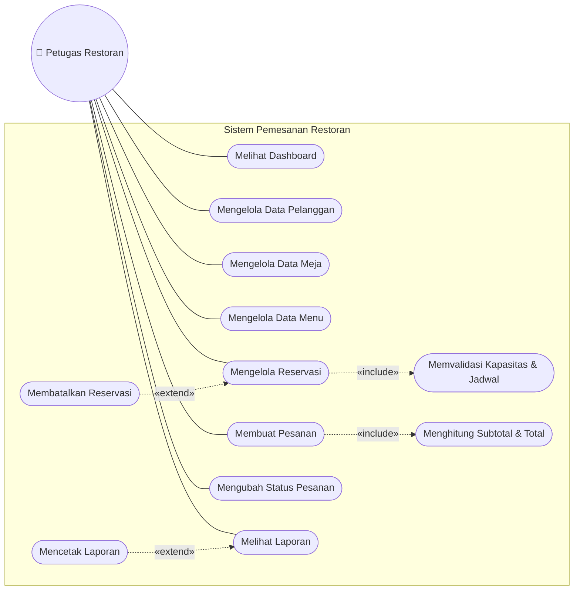
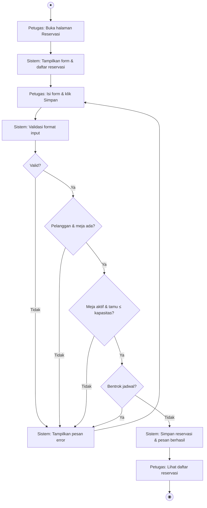
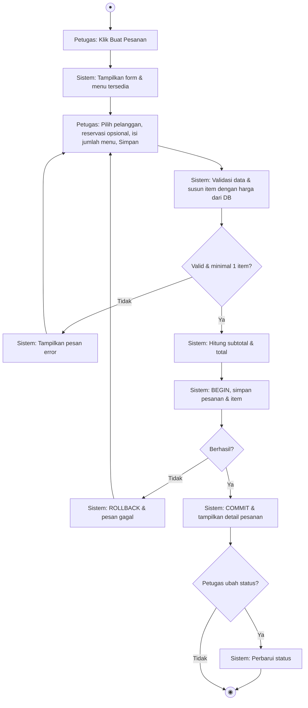
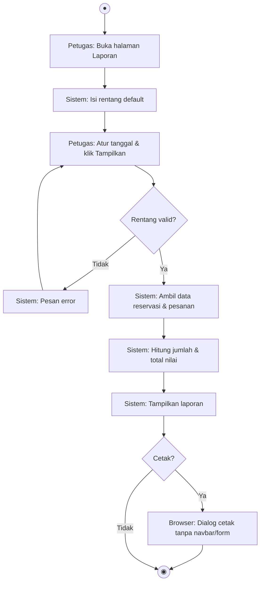
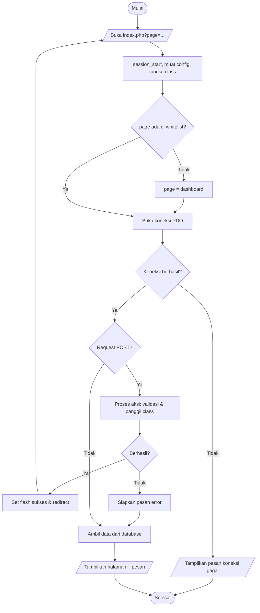
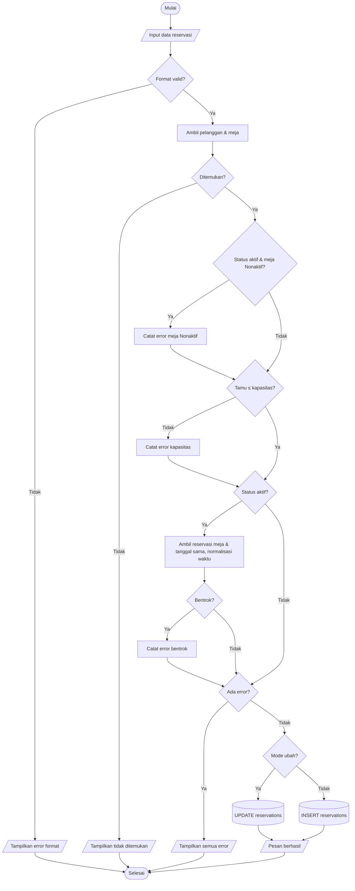
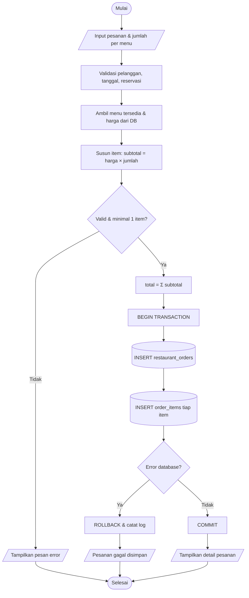
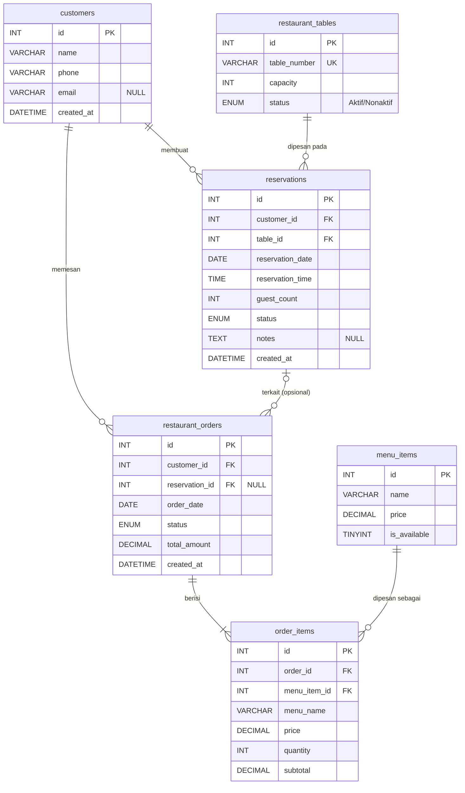

# Panduan Pembuatan Laporan DOCX & Diagram draw.io — Sistem Pemesanan Restoran

> Dokumen ini adalah **brief lengkap** untuk Claude (atau pembuat dokumen lain) yang akan membuat:
> 1. **Laporan Pengembangan dalam format `.docx`**, dan
> 2. **Diagram dalam format draw.io (`.drawio`)**: Use Case, Activity, Flowchart, dan ERD, beserta ekspor gambarnya untuk disisipkan ke DOCX.
>
> Semua informasi proyek yang dibutuhkan ada di dokumen ini. Pembuat **tidak perlu** dan **tidak bisa** mengakses kode sumber. Jangan menambah fitur, angka, atau hasil pengujian yang tidak tertulis di sini.

---

## Daftar Isi Panduan

0. [Instruksi untuk Pembuat Dokumen](#0-instruksi-untuk-pembuat-dokumen)
1. [Ringkasan Proyek](#1-ringkasan-proyek)
2. [Fitur dan Aturan Bisnis](#2-fitur-dan-aturan-bisnis)
3. [Struktur Proyek dan Kode](#3-struktur-proyek-dan-kode)
4. [Desain Database Lengkap](#4-desain-database-lengkap)
5. [Spesifikasi Diagram](#5-spesifikasi-diagram)
6. [Struktur DOCX Bab demi Bab](#6-struktur-docx-bab-demi-bab)
7. [Data Pengujian dan Debugging (Data Asli)](#7-data-pengujian-dan-debugging-data-asli)
8. [Format dan Gaya DOCX](#8-format-dan-gaya-docx)
9. [Gambaran Hasil Akhir](#9-gambaran-hasil-akhir)
10. [Checklist Penerimaan](#10-checklist-penerimaan)

---

## 0. Instruksi untuk Pembuat Dokumen

**Peran:** Anda adalah penulis dokumentasi teknis yang menyusun laporan pengembangan untuk uji kompetensi **Sertifikasi LSP Programmer** (skema Programmer, BNSP). Pembaca laporan adalah asesor yang menilai kompetensi pemrograman.

**Output yang diminta:**

| No | File | Keterangan |
|---|---|---|
| 1 | `Laporan-Pengembangan-Sistem-Pemesanan-Restoran.docx` | Laporan utama (struktur di Bagian 6, gaya di Bagian 8). |
| 2 | `01-use-case.drawio` | Use Case Diagram (Bagian 5.1). |
| 3 | `02-activity-reservasi.drawio` | Activity Diagram membuat/mengubah reservasi (Bagian 5.2.1). |
| 4 | `03-activity-pesanan.drawio` | Activity Diagram membuat pesanan (Bagian 5.2.2). |
| 5 | `04-activity-laporan.drawio` | Activity Diagram melihat & mencetak laporan (Bagian 5.2.3). |
| 6 | `05-flowchart-alur-umum.drawio` | Flowchart alur umum aplikasi (Bagian 5.3.1). |
| 7 | `06-flowchart-reservasi.drawio` | Flowchart validasi & simpan reservasi (Bagian 5.3.2). |
| 8 | `07-flowchart-pesanan.drawio` | Flowchart simpan pesanan dengan transaksi (Bagian 5.3.3). |
| 9 | `08-erd.drawio` | ERD / desain database (Bagian 5.4). |
| 10 | `01-use-case.png` … `08-erd.png` | Ekspor PNG setiap diagram (skala 2×, latar putih) untuk disisipkan ke DOCX. |

Sebagai alternatif dari file 2–9, boleh dibuat **satu file `diagram-sistem-restoran.drawio` multi-halaman** (satu tab per diagram, nama tab sama dengan nama file di atas).

**Aturan wajib:**

1. **Jangan mengarang.** Hasil unit test, uji end-to-end, dan kasus debugging di Bagian 7 adalah data asli. Salin apa adanya.
2. **Konsisten dengan implementasi.** Nama tabel, kolom, status, dan aturan validasi harus sama persis dengan Bagian 2 dan 4.
3. **Bahasa Indonesia** yang baku dan ringkas. Istilah teknis (PDO, prepared statement, foreign key) boleh tetap dalam bahasa Inggris dan dicetak miring bila perlu.
4. **Identitas peserta memakai placeholder**: `[Nama Peserta]`, `[No. Peserta]`, `[Tanggal Uji]`, `[Nama Asesor]`. Jangan diisi nama karangan.
5. **Tidak terlalu kompleks.** Laporan sekitar **20–30 halaman** termasuk gambar. Diagram rapi dan mudah dibaca, tanpa elemen yang tidak ada di aplikasi.
6. Diagram di DOCX harus **sama persis** dengan file `.drawio` (gambar diekspor dari file tersebut).
7. Sertakan **file `.drawio` yang dapat dibuka** di <https://app.diagrams.net> (format XML `mxfile`, tidak terkompresi lebih disarankan agar bisa diperiksa).

---

## 1. Ringkasan Proyek

| Item | Keterangan |
|---|---|
| Nama aplikasi | **Sistem Pemesanan Restoran** (nama brand di navbar: "Restoran Kita") |
| Jenis | Aplikasi web sederhana, dijalankan lokal (XAMPP / Laragon) |
| Tujuan | Mencatat pelanggan, meja, menu, reservasi meja, pesanan menu, dan menampilkan laporan yang dapat dicetak |
| Konteks | Tugas praktik demonstrasi Sertifikasi LSP Programmer |
| Pengguna (aktor) | **Petugas Restoran** (satu jenis pengguna; aplikasi **tanpa login** sesuai spesifikasi) |
| Bahasa antarmuka | Indonesia |
| Repositori | `Fuentes771/LSP-Programming` (GitHub) |

**Latar belakang singkat:** pencatatan reservasi dan pesanan secara manual rawan kesalahan, misalnya meja terpesan dua kali pada jam yang sama, jumlah tamu melebihi kapasitas meja, atau total pesanan salah hitung. Aplikasi ini mencegah kesalahan tersebut lewat validasi di server dan perhitungan otomatis.

### Teknologi

| Teknologi | Versi / Keterangan | Kegunaan |
|---|---|---|
| PHP Native | 8.1+ (diuji dengan PHP 8.3.6 CLI) | Bahasa sisi server, tanpa framework |
| MySQL / MariaDB | MySQL 5.7+ / MariaDB 10.3+ (diuji dengan MariaDB 10.11.14) | Basis data relasional (InnoDB, utf8mb4) |
| PDO (`pdo_mysql`) | bawaan PHP | Koneksi database, *prepared statement*, transaksi |
| Bootstrap | 5.3.3 via CDN jsDelivr | Komponen UI: navbar, grid, card, table, form, alert, badge, button |
| HTML & CSS | — | Struktur halaman dan gaya cetak (`@media print`) |
| PHP CLI | — | Menjalankan unit test `php tests/test_functions.php` |
| XAMPP / Laragon | — | Lingkungan server lokal (Apache + PHP + MySQL) |

Yang **tidak** dipakai (sesuai batasan spesifikasi): Laravel, React, Docker, REST API, login/hak akses, pembayaran online, ekspor PDF/Excel.

---

## 2. Fitur dan Aturan Bisnis

### 2.1 Daftar Fitur

| Kode | Fitur | Rincian |
|---|---|---|
| F1 | Dashboard | 4 kartu ringkasan: jumlah pelanggan, meja, reservasi, pesanan. Tabel **5 reservasi terbaru**. |
| F2 | Data Pelanggan | Lihat daftar, tambah, ubah, hapus. Data: nama, nomor telepon, email (boleh kosong). |
| F3 | Data Meja | Lihat daftar, tambah, ubah, hapus. Data: nomor meja (unik), kapasitas, status **Aktif/Nonaktif**. |
| F4 | Data Menu | Lihat daftar, tambah, ubah, hapus. Data: nama menu, harga, status **Tersedia/Tidak Tersedia**. |
| F5 | Reservasi Meja | Buat, lihat, ubah, **batalkan**. Data: pelanggan, meja, tanggal, waktu, jumlah tamu, status, catatan (opsional). |
| F6 | Pesanan | Buat pesanan untuk pelanggan (reservasi opsional), pilih satu atau lebih menu beserta jumlahnya. Lihat daftar & detail, ubah status. |
| F7 | Laporan | Laporan reservasi dan pesanan berdasarkan rentang tanggal, ringkasan jumlah & total nilai, tombol **Cetak** (fitur cetak browser). |

### 2.2 Status yang Digunakan

| Entitas | Nilai status | Catatan |
|---|---|---|
| Meja | `Aktif`, `Nonaktif` | Meja Nonaktif tidak muncul di pilihan reservasi baru. |
| Menu | `1` = Tersedia, `0` = Tidak Tersedia | Menu tidak tersedia tidak bisa dipesan. |
| Reservasi | `Menunggu`, `Dikonfirmasi`, `Selesai`, `Dibatalkan` | **Reservasi aktif** = `Menunggu` atau `Dikonfirmasi`. |
| Pesanan | `Diproses`, `Selesai`, `Dibatalkan` | Pesanan baru selalu berstatus `Diproses`. |

Warna badge status di UI: Aktif/Selesai = hijau, Menunggu/Diproses = kuning, Dikonfirmasi = biru, Dibatalkan = merah, Nonaktif = abu-abu.

### 2.3 Aturan Validasi (semua dilakukan di server)

**Pelanggan**
- Nama wajib diisi, maksimal 100 karakter.
- Nomor telepon 8–15 digit angka, boleh diawali `+`.
- Email boleh kosong; jika diisi harus berformat email valid.

**Meja**
- Nomor meja wajib, maksimal 10 karakter, **unik** (duplikat ditolak: *"Nomor meja "M05" sudah digunakan."*).
- Kapasitas bilangan bulat > 0.
- Status harus `Aktif` atau `Nonaktif`.

**Menu**
- Nama wajib, maksimal 100 karakter.
- Harga berupa angka **> 0** (nol/negatif/bukan angka ditolak).
- Status ketersediaan `0` atau `1`.

**Reservasi** (urutan pemeriksaan di `Reservation::save()`)
1. Validasi format: pelanggan & meja dipilih, tanggal valid (`Y-m-d`, misalnya 2026-02-30 ditolak), waktu valid (`HH:MM` atau `HH:MM:SS`), jumlah tamu bilangan bulat > 0, status valid.
2. Pelanggan harus ada di database.
3. Meja harus ada di database.
4. Jika status yang disimpan **aktif** dan meja **Nonaktif**, ditolak: *"Meja M04 sedang Nonaktif dan tidak dapat direservasi."*
5. **Jumlah tamu ≤ kapasitas meja**, jika tidak: *"Jumlah tamu (5) melebihi kapasitas meja M02 (4 orang)."*
6. Jika status aktif: **tidak boleh ada reservasi aktif lain** pada **meja + tanggal + waktu yang sama**. Reservasi yang sedang diubah dikecualikan dari pemeriksaan. Jika bentrok: *"Meja M02 sudah memiliki reservasi aktif pada tanggal dan waktu tersebut."*
7. Waktu dinormalisasi ke `HH:MM:SS` sebelum dibandingkan dan disimpan, karena form mengirim `19:00` sedangkan database mengembalikan `19:00:00`.
8. Pesan error langkah 4–6 dikumpulkan dan ditampilkan bersama. Form tetap terisi agar pengguna bisa memperbaiki.

**Batalkan reservasi:** status diubah menjadi `Dibatalkan` (data **tidak dihapus**). Hanya reservasi `Menunggu`/`Dikonfirmasi` yang dapat dibatalkan. Slot meja dari reservasi yang dibatalkan dapat dipakai lagi.

**Pesanan** (`Order::create()`)
1. Pelanggan wajib dipilih dan harus ada.
2. Tanggal pesanan valid.
3. Reservasi **opsional**. Jika dipilih: harus ada, **milik pelanggan yang sama**, dan **tidak berstatus Dibatalkan**.
4. Item dibangun dari input jumlah per menu (`buildOrderItems()`):
   - jumlah kosong atau `0` berarti menu tidak dipesan,
   - jumlah harus bilangan bulat > 0 (negatif/desimal ditolak),
   - hanya menu **tersedia** yang boleh dipesan,
   - minimal **satu** menu harus dipilih.
5. **Harga diambil dari database**, bukan dari form. Harga dan nama menu **disalin** ke `order_items`, sehingga perubahan harga menu di kemudian hari tidak mengubah pesanan lama.
6. `subtotal = harga × jumlah`; `total = Σ subtotal` (dibulatkan 2 desimal).
7. Penyimpanan dalam **satu transaksi**: `BEGIN` → INSERT `restaurant_orders` → INSERT setiap `order_items` → `COMMIT`. Jika terjadi error: `ROLLBACK`, pengguna melihat *"Pesanan gagal disimpan. Silakan coba lagi."*, dan detail error hanya dicatat ke log server.
8. Setelah tersimpan, pengguna diarahkan ke halaman **Detail Pesanan** yang bisa dipakai untuk mengubah status.

**Laporan**
- Input: tanggal awal & akhir (default: tanggal 1 bulan berjalan s.d. hari ini).
- Tanggal awal tidak boleh melebihi tanggal akhir.
- Laporan reservasi difilter berdasarkan `reservation_date`; laporan pesanan berdasarkan `order_date`.
- Ringkasan: **jumlah reservasi**, **jumlah pesanan**, **total nilai pesanan** (pesanan `Dibatalkan` **tidak dihitung**).
- Tombol **Cetak** memanggil `window.print()`; navbar, form filter, dan tombol disembunyikan saat dicetak.

**Proteksi hapus (relasi tidak boleh rusak)**

| Data | Ditolak jika | Pesan |
|---|---|---|
| Pelanggan | punya reservasi atau pesanan | "Pelanggan tidak dapat dihapus karena masih memiliki data reservasi atau pesanan." |
| Meja | punya reservasi | "Meja tidak dapat dihapus karena masih memiliki data reservasi. Ubah statusnya menjadi Nonaktif." |
| Menu | pernah dipesan | "Menu tidak dapat dihapus karena sudah pernah dipesan. Ubah statusnya menjadi Tidak Tersedia." |

Selain pengecekan di aplikasi, *foreign key* `ON DELETE RESTRICT` di database menjadi pengaman kedua (error SQLSTATE `23000` ditangkap dan diubah menjadi pesan ramah).

**Pesan umum:** setiap aksi menampilkan pesan berhasil (alert hijau) atau gagal (alert merah). Pola **Post/Redirect/Get** dipakai agar form tidak terkirim ulang saat halaman di-refresh.

### 2.4 Keamanan Dasar

- Semua query yang menerima input memakai *prepared statement* PDO; tidak ada penggabungan string input ke SQL.
- Semua output di-*escape* dengan `htmlspecialchars` (fungsi `e()`) untuk mencegah XSS.
- Halaman yang boleh dibuka dibatasi dengan *whitelist* parameter `?page=`; nilai lain diarahkan ke dashboard.
- File halaman (`pages/*.php`) dan template tampilan tidak bisa diakses langsung.
- Aksi hapus/batal memakai form POST + konfirmasi JavaScript.
- Error database: pengguna hanya melihat pesan umum, sedangkan detail dicatat dengan `error_log()`. Password tidak pernah ditampilkan.

---

## 3. Struktur Proyek dan Kode

### 3.1 Struktur Folder

```text
LSP-Programming/
├── config/
│   └── database.php          # konstanta DB_HOST/DB_PORT/DB_NAME/DB_USER/DB_PASS + getConnection()
├── classes/
│   ├── BaseModel.php         # class abstrak induk
│   ├── Customer.php
│   ├── RestaurantTable.php
│   ├── MenuItem.php
│   ├── Reservation.php
│   └── Order.php
├── includes/
│   ├── functions.php         # fungsi validasi, perhitungan, helper tampilan
│   ├── header.php            # <head>, Bootstrap CSS, flash message
│   ├── navbar.php            # navigasi
│   └── footer.php            # Bootstrap JS
├── pages/
│   ├── dashboard.php
│   ├── customers.php
│   ├── tables.php
│   ├── menu.php
│   ├── reservations.php
│   ├── orders.php            # mode: daftar, buat (?action=create), detail (?action=view&id=)
│   └── reports.php
├── tests/
│   └── test_functions.php    # unit test CLI, output PASS/FAIL, exit code 0/1
├── docs/
│   ├── laporan.md            # laporan versi Markdown
│   └── presentasi.md         # outline 8 slide
├── database.sql              # pembuatan database restoran_db + data contoh
├── index.php                 # titik masuk: index.php?page=<nama>
└── README.md                 # cara instalasi & menjalankan
```

### 3.2 Arsitektur Singkat

```text
Browser ──► index.php?page=xxx ──► pages/xxx.php ──► classes/*.php ──► PDO ──► MySQL/MariaDB
               │                        │
               │                        ├─ includes/functions.php (validasi & perhitungan)
               │                        └─ includes/header.php, navbar.php, footer.php (tampilan)
               └─ session_start, whitelist halaman, tangkap PDOException
```

Alur sebuah halaman: (1) jika request POST, proses aksi → validasi → panggil method class → set pesan flash → redirect; (2) jika GET, ambil data dari class → render HTML dengan Bootstrap.

### 3.3 Class (OOP)

```text
                 ┌──────────────────────────────┐
                 │   «abstract» BaseModel       │
                 │ # db : PDO                   │
                 │ # table : string             │
                 │ + __construct(PDO db)        │
                 │ + count() : int              │
                 │ + find(int id) : ?array      │
                 │ # countRelated(...) : int    │
                 │ # isConstraintError(e): bool │
                 └──────────────┬───────────────┘
        ┌───────────┬───────────┼────────────┬──────────────┐
   Customer   RestaurantTable  MenuItem   Reservation      Order
```

| Class | Tabel | Method publik | Tanggung jawab |
|---|---|---|---|
| `BaseModel` (abstract) | — | `count()`, `find()` | Menyimpan koneksi PDO, method umum, cek relasi & constraint |
| `Customer` | `customers` | `all()`, `save()`, `delete()` | CRUD pelanggan + cek relasi sebelum hapus |
| `RestaurantTable` | `restaurant_tables` | `all()`, `active()`, `save()`, `delete()` | CRUD meja, nomor meja unik |
| `MenuItem` | `menu_items` | `all()`, `available()`, `save()`, `delete()` | CRUD menu, daftar menu tersedia |
| `Reservation` | `reservations` | `all()`, `latest()`, `selectable()`, `between()`, `save()`, `cancel()` | Aturan kapasitas & bentrok jadwal, pembatalan, laporan |
| `Order` | `restaurant_orders`, `order_items` | `all()`, `between()`, `findWithItems()`, `create()`, `updateStatus()` | Simpan pesanan + item dalam transaksi, detail, laporan |

Konsep OOP yang ditunjukkan: **abstraksi** (class abstrak), **pewarisan** (`extends BaseModel`), **enkapsulasi** (property `protected`, method `private onTableAndDate()`), dan ***dependency injection*** (PDO lewat constructor; `Order::create()` menerima objek `MenuItem`).

### 3.4 Fungsi (Pemrograman Terstruktur) — `includes/functions.php`

| Kelompok | Fungsi |
|---|---|
| Perhitungan | `calculateSubtotal($price, $qty)`, `calculateOrderTotal($items)`, `buildOrderItems($quantities, $menus)` |
| Validasi dasar | `isRequired()`, `isValidEmail()`, `isValidPhone()`, `isValidDate()`, `isValidTime()`, `normalizeTime()`, `isPositiveInteger()`, `validatePrice()`, `validateQuantity()`, `validateCapacity()`, `validateGuestCount()` |
| Aturan bisnis | `hasReservationConflict($existing, $tableId, $date, $time, $excludeId)` |
| Validasi entitas | `validateCustomerData()`, `validateTableData()`, `validateMenuData()`, `validateReservationData()`, `validateDateRange()` (mengembalikan daftar pesan error) |
| Helper tampilan | `e()`, `formatRupiah()`, `formatDate()`, `formatTime()`, `statusBadgeClass()`, `setFlash()`, `getFlash()`, `redirect()`, `pageUrl()`, `showErrors()`, `actionButton()`, `input()` |

Fungsi-fungsi ini **tidak mengakses database**, sehingga bisa diuji langsung dari terminal.

### 3.5 Cuplikan Kode Kunci (boleh dikutip di DOCX)

```php
function calculateSubtotal($price, $quantity): float
{
    return round((float) $price * (int) $quantity, 2);
}

function calculateOrderTotal(array $items): float
{
    $total = 0.0;
    foreach ($items as $item) {
        $total += calculateSubtotal($item['price'], $item['quantity']);
    }
    return round($total, 2);
}

/** Jumlah tamu minimal 1 dan tidak boleh melebihi kapasitas meja. */
function validateGuestCount($guestCount, $capacity): bool
{
    return isPositiveInteger($guestCount) && (int) $guestCount <= (int) $capacity;
}
```

```php
function hasReservationConflict(array $existing, int $tableId, string $date, string $time, ?int $excludeId = null): bool
{
    $time = normalizeTime($time);
    foreach ($existing as $reservation) {
        if ($excludeId !== null && (int) $reservation['id'] === $excludeId) {
            continue;
        }
        if ((int) $reservation['table_id'] === $tableId
            && $reservation['reservation_date'] === $date
            && normalizeTime($reservation['reservation_time']) === $time
            && in_array($reservation['status'], ACTIVE_RESERVATION_STATUSES, true)) {
            return true;
        }
    }
    return false;
}
```

```php
// Order::create() — transaksi (diringkas)
try {
    $this->db->beginTransaction();
    // INSERT INTO restaurant_orders (...) VALUES (?, ?, ?, 'Diproses', ?)
    $orderId = (int) $this->db->lastInsertId();
    // INSERT INTO order_items (...) VALUES (?, ?, ?, ?, ?, ?)  -- untuk setiap item
    $this->db->commit();
} catch (PDOException $e) {
    if ($this->db->inTransaction()) {
        $this->db->rollBack();   // tidak ada data tersimpan setengah
    }
    error_log('Gagal menyimpan pesanan: ' . $e->getMessage());
    return ['errors' => ['Pesanan gagal disimpan. Silakan coba lagi.'], 'id' => null];
}
```

```php
// config/database.php — koneksi PDO (diringkas)
$pdo = new PDO($dsn, DB_USER, DB_PASS, [
    PDO::ATTR_ERRMODE            => PDO::ERRMODE_EXCEPTION,
    PDO::ATTR_DEFAULT_FETCH_MODE => PDO::FETCH_ASSOC,
    PDO::ATTR_EMULATE_PREPARES   => false,
]);
```

---

## 4. Desain Database Lengkap

Nama database: **`restoran_db`**, engine **InnoDB**, charset **utf8mb4** (`utf8mb4_unicode_ci`). Jumlah tabel: **6**.

### 4.1 Kamus Data

**Tabel `customers`**: data pelanggan

| Kolom | Tipe | Null | Default | Key | Keterangan |
|---|---|---|---|---|---|
| id | INT UNSIGNED AUTO_INCREMENT | Tidak | — | PK | ID pelanggan |
| name | VARCHAR(100) | Tidak | — | | Nama pelanggan |
| phone | VARCHAR(20) | Tidak | — | | Nomor telepon (8–15 digit) |
| email | VARCHAR(100) | Ya | NULL | | Email (opsional) |
| created_at | DATETIME | Tidak | CURRENT_TIMESTAMP | | Waktu data dibuat |

**Tabel `restaurant_tables`**: data meja

| Kolom | Tipe | Null | Default | Key | Keterangan |
|---|---|---|---|---|---|
| id | INT UNSIGNED AUTO_INCREMENT | Tidak | — | PK | ID meja |
| table_number | VARCHAR(10) | Tidak | — | UNIQUE | Nomor meja, misalnya M01 |
| capacity | INT UNSIGNED | Tidak | — | | Kapasitas (orang) |
| status | ENUM('Aktif','Nonaktif') | Tidak | 'Aktif' | | Status meja |

**Tabel `menu_items`**: data menu

| Kolom | Tipe | Null | Default | Key | Keterangan |
|---|---|---|---|---|---|
| id | INT UNSIGNED AUTO_INCREMENT | Tidak | — | PK | ID menu |
| name | VARCHAR(100) | Tidak | — | | Nama menu |
| price | DECIMAL(12,2) | Tidak | — | | Harga saat ini |
| is_available | TINYINT(1) | Tidak | 1 | | 1 = tersedia, 0 = tidak tersedia |

**Tabel `reservations`**: reservasi meja

| Kolom | Tipe | Null | Default | Key | Keterangan |
|---|---|---|---|---|---|
| id | INT UNSIGNED AUTO_INCREMENT | Tidak | — | PK | ID reservasi |
| customer_id | INT UNSIGNED | Tidak | — | FK → customers.id | Pelanggan |
| table_id | INT UNSIGNED | Tidak | — | FK → restaurant_tables.id | Meja |
| reservation_date | DATE | Tidak | — | INDEX* | Tanggal reservasi |
| reservation_time | TIME | Tidak | — | INDEX* | Waktu reservasi |
| guest_count | INT UNSIGNED | Tidak | — | | Jumlah tamu |
| status | ENUM('Menunggu','Dikonfirmasi','Selesai','Dibatalkan') | Tidak | 'Menunggu' | | Status reservasi |
| notes | TEXT | Ya | NULL | | Catatan (opsional) |
| created_at | DATETIME | Tidak | CURRENT_TIMESTAMP | | Waktu data dibuat |

\* Index gabungan `idx_reservation_slot (table_id, reservation_date, reservation_time)` untuk mempercepat pengecekan bentrok.

**Tabel `restaurant_orders`**: header pesanan

| Kolom | Tipe | Null | Default | Key | Keterangan |
|---|---|---|---|---|---|
| id | INT UNSIGNED AUTO_INCREMENT | Tidak | — | PK | ID / nomor pesanan |
| customer_id | INT UNSIGNED | Tidak | — | FK → customers.id | Pelanggan |
| reservation_id | INT UNSIGNED | **Ya** | NULL | FK → reservations.id | Reservasi terkait (opsional) |
| order_date | DATE | Tidak | — | | Tanggal pesanan |
| status | ENUM('Diproses','Selesai','Dibatalkan') | Tidak | 'Diproses' | | Status pesanan |
| total_amount | DECIMAL(12,2) | Tidak | 0 | | Total = Σ subtotal item |
| created_at | DATETIME | Tidak | CURRENT_TIMESTAMP | | Waktu data dibuat |

**Tabel `order_items`**: detail item pesanan

| Kolom | Tipe | Null | Default | Key | Keterangan |
|---|---|---|---|---|---|
| id | INT UNSIGNED AUTO_INCREMENT | Tidak | — | PK | ID item |
| order_id | INT UNSIGNED | Tidak | — | FK → restaurant_orders.id | Pesanan induk |
| menu_item_id | INT UNSIGNED | Tidak | — | FK → menu_items.id | Menu yang dipesan |
| menu_name | VARCHAR(100) | Tidak | — | | **Salinan** nama menu saat dipesan |
| price | DECIMAL(12,2) | Tidak | — | | **Salinan** harga saat dipesan |
| quantity | INT UNSIGNED | Tidak | — | | Jumlah |
| subtotal | DECIMAL(12,2) | Tidak | — | | price × quantity |

### 4.2 Relasi

| No | Relasi | Kardinalitas | Foreign key | ON DELETE | ON UPDATE |
|---|---|---|---|---|---|
| R1 | customers → reservations | 1 : 0..N | reservations.customer_id | RESTRICT | CASCADE |
| R2 | restaurant_tables → reservations | 1 : 0..N | reservations.table_id | RESTRICT | CASCADE |
| R3 | customers → restaurant_orders | 1 : 0..N | restaurant_orders.customer_id | RESTRICT | CASCADE |
| R4 | reservations → restaurant_orders | 0..1 : 0..N (opsional) | restaurant_orders.reservation_id (NULL) | RESTRICT | CASCADE |
| R5 | restaurant_orders → order_items | 1 : 1..N* | order_items.order_id | **CASCADE** | CASCADE |
| R6 | menu_items → order_items | 1 : 0..N | order_items.menu_item_id | RESTRICT | CASCADE |

\* Minimal satu item dijamin oleh aplikasi (`buildOrderItems()`), bukan oleh constraint database.

**Catatan desain yang perlu dijelaskan di laporan:**
- Harga & total memakai `DECIMAL(12,2)` (bukan teks/float) agar perhitungan uang tepat.
- `order_items.menu_name` dan `order_items.price` adalah salinan (*snapshot*) agar pesanan lama tidak berubah saat harga menu diubah.
- `RESTRICT` mencegah data induk yang masih dipakai ikut terhapus. `CASCADE` hanya pada `order_items.order_id` karena item tidak bermakna tanpa pesanannya.
- `restaurant_orders.reservation_id` boleh NULL karena pesanan bisa tanpa reservasi.

### 4.3 Data Contoh (dari `database.sql`)

| Tabel | Data |
|---|---|
| customers | Budi Santoso (081234567890, budi@example.com), Siti Aminah (082345678901, tanpa email), Andi Wijaya (083456789012, andi@example.com) |
| restaurant_tables | M01 (2 orang, Aktif), M02 (4, Aktif), M03 (6, Aktif), M04 (8, Nonaktif) |
| menu_items | Nasi Goreng Spesial Rp25.000, Mie Ayam Bakso Rp20.000, Ayam Bakar Rp30.000, Es Teh Manis Rp5.000, Jus Alpukat Rp15.000 (tidak tersedia) |

---

## 5. Spesifikasi Diagram

### 5.0 Konvensi Umum draw.io

| Aspek | Ketentuan |
|---|---|
| Format file | `.drawio` (XML `mxfile`), bisa dibuka di app.diagrams.net |
| Halaman | Satu diagram per file (atau satu tab per diagram bila memakai satu file) |
| Font | Helvetica/Arial 12 pt untuk isi, 14 pt tebal untuk judul/nama entitas |
| Warna | Netral dan konsisten: isi putih atau biru muda (`#DAE8FC`, garis `#6C8EBF`) untuk proses/use case, kuning muda (`#FFF2CC`, garis `#D6B656`) untuk keputusan, hijau muda (`#D5E8D4`, garis `#82B366`) untuk mulai/selesai flowchart, abu-abu muda (`#F5F5F5`) untuk header tabel ERD |
| Garis | Hitam/abu tua, 1 pt; garis siku (*orthogonal*) untuk activity, flowchart, ERD |
| Label | Bahasa Indonesia; label cabang keputusan **"Ya"/"Tidak"** |
| Ekspor | PNG, skala **2×**, latar **putih**, border 10 px, nama file sama dengan `.drawio` |
| Ukuran | Muat di halaman A4 portrait (lebar gambar di DOCX ±15–16 cm). Jika diagram tinggi, maksimal 1 halaman per gambar. |

**Style draw.io yang disarankan:**

| Elemen | Style |
|---|---|
| Aktor | `shape=umlActor;verticalLabelPosition=bottom;verticalAlign=top;html=1;` |
| Use case | `ellipse;whiteSpace=wrap;html=1;fillColor=#dae8fc;strokeColor=#6c8ebf;` |
| Batas sistem | `rounded=0;whiteSpace=wrap;html=1;fillColor=none;verticalAlign=top;fontStyle=1;` |
| Asosiasi | `endArrow=none;html=1;` |
| Include/Extend | `endArrow=open;dashed=1;html=1;` dengan label `«include»` / `«extend»` |
| Start (activity) | `ellipse;fillColor=#000000;strokeColor=#000000;` (lingkaran hitam 30×30) |
| End (activity) | `ellipse;html=1;shape=endState;fillColor=#000000;strokeColor=#000000;` |
| Aksi (activity) | `rounded=1;whiteSpace=wrap;html=1;arcSize=40;fillColor=#dae8fc;strokeColor=#6c8ebf;` |
| Keputusan | `rhombus;whiteSpace=wrap;html=1;fillColor=#fff2cc;strokeColor=#d6b656;` |
| Swimlane | `swimlane;html=1;startSize=30;horizontal=1;` (2 lajur berdampingan: Petugas, Sistem) |
| Terminator (flowchart) | `rounded=1;whiteSpace=wrap;html=1;arcSize=50;fillColor=#d5e8d4;strokeColor=#82b366;` |
| Proses (flowchart) | `rounded=0;whiteSpace=wrap;html=1;` |
| Input/Output | `shape=parallelogram;perimeter=parallelogramPerimeter;whiteSpace=wrap;html=1;fixedSize=1;` |
| Database | `shape=cylinder3;whiteSpace=wrap;html=1;boundedLbl=1;size=10;` |
| Entitas ERD | `shape=table;startSize=30;container=1;collapsible=0;childLayout=tableLayout;fixedRows=1;rowLines=0;fontStyle=1;align=center;` (atau "Entity Relation → Table" dari pustaka draw.io) |
| Relasi ERD | `edgeStyle=entityRelationEdgeStyle;endArrow=ERmany;startArrow=ERmandOne;html=1;` (sesuaikan: `ERzeroToMany`, `ERoneToMany`, `ERzeroToOne`) |

> Blok **Mermaid** di bawah hanya **sketsa gambaran** isi dan alur. Hasil akhir dibuat di draw.io sesuai notasi UML/flowchart standar, bukan screenshot Mermaid.

---

### 5.1 Use Case Diagram — `01-use-case.drawio`

**Tujuan:** menggambarkan interaksi aktor dengan fungsi-fungsi sistem.

**Elemen:**
- **Aktor:** `Petugas Restoran` (kiri, di luar batas sistem).
- **Batas sistem:** persegi berlabel `Sistem Pemesanan Restoran`.
- **Use case (12):**

| Kode | Use case | Hubungan |
|---|---|---|
| UC-01 | Melihat Dashboard | asosiasi dengan aktor |
| UC-02 | Mengelola Data Pelanggan | asosiasi |
| UC-03 | Mengelola Data Meja | asosiasi |
| UC-04 | Mengelola Data Menu | asosiasi |
| UC-05 | Mengelola Reservasi | asosiasi |
| UC-06 | Memvalidasi Kapasitas & Jadwal | UC-05 `«include»` UC-06 |
| UC-07 | Membatalkan Reservasi | UC-07 `«extend»` UC-05 |
| UC-08 | Membuat Pesanan | asosiasi |
| UC-09 | Menghitung Subtotal & Total | UC-08 `«include»` UC-09 |
| UC-10 | Mengubah Status Pesanan | asosiasi |
| UC-11 | Melihat Laporan | asosiasi |
| UC-12 | Mencetak Laporan | UC-12 `«extend»` UC-11 |

Arah panah: `«include»` dari use case dasar **ke** use case yang di-include; `«extend»` dari use case perluasan **ke** use case dasar.

**Tata letak:** aktor di kiri tengah. Use case utama (UC-01…05, 08, 10, 11) tersusun vertikal di kolom kiri batas sistem; use case include/extend (UC-06, 07, 09, 12) di kolom kanan sejajar dengan use case dasarnya.



**Tabel deskripsi use case (untuk DOCX):**

| Kode | Nama | Deskripsi singkat | Kondisi akhir |
|---|---|---|---|
| UC-01 | Melihat Dashboard | Petugas melihat jumlah pelanggan, meja, reservasi, pesanan, dan 5 reservasi terbaru. | Ringkasan tampil. |
| UC-02 | Mengelola Data Pelanggan | Menambah, mengubah, menghapus, dan melihat pelanggan. | Data tersimpan/terhapus; hapus ditolak bila berelasi. |
| UC-03 | Mengelola Data Meja | Menambah, mengubah, menghapus, dan melihat meja beserta kapasitas & status. | Data tersimpan; nomor meja unik. |
| UC-04 | Mengelola Data Menu | Menambah, mengubah, menghapus, dan melihat menu beserta harga & ketersediaan. | Data tersimpan; harga > 0. |
| UC-05 | Mengelola Reservasi | Membuat, melihat, dan mengubah reservasi. | Reservasi tersimpan jika lolos validasi. |
| UC-06 | Memvalidasi Kapasitas & Jadwal | Sistem memeriksa meja aktif, jumlah tamu ≤ kapasitas, dan tidak bentrok. | Lolos atau pesan error. |
| UC-07 | Membatalkan Reservasi | Mengubah status reservasi aktif menjadi Dibatalkan. | Status Dibatalkan; slot dapat dipakai lagi. |
| UC-08 | Membuat Pesanan | Memilih pelanggan, reservasi (opsional), menu, dan jumlah. | Pesanan + item tersimpan dalam transaksi. |
| UC-09 | Menghitung Subtotal & Total | Sistem menghitung subtotal per item dan total dari harga database. | Total tersimpan di pesanan. |
| UC-10 | Mengubah Status Pesanan | Mengubah status menjadi Diproses/Selesai/Dibatalkan pada halaman detail. | Status diperbarui. |
| UC-11 | Melihat Laporan | Memilih rentang tanggal untuk laporan reservasi & pesanan. | Laporan dan ringkasan tampil. |
| UC-12 | Mencetak Laporan | Mencetak laporan lewat fitur cetak browser. | Dokumen tercetak tanpa navbar/form. |

---

### 5.2 Activity Diagram

Semua activity diagram memakai **2 swimlane**: **Petugas** (kiri) dan **Sistem** (kanan). Mulai dengan simbol *initial node*, akhiri dengan *final node*. Cabang keputusan berlabel `[Ya]`/`[Tidak]` atau `[valid]`/`[tidak valid]`.

#### 5.2.1 Membuat / Mengubah Reservasi — `02-activity-reservasi.drawio`

| No | Lajur | Aktivitas |
|---|---|---|
| 1 | Petugas | ● Mulai → Membuka halaman **Reservasi** |
| 2 | Sistem | Menampilkan form reservasi (pilihan pelanggan, meja **Aktif**) dan daftar reservasi |
| 3 | Petugas | Mengisi pelanggan, meja, tanggal, waktu, jumlah tamu, status, catatan → klik **Simpan** |
| 4 | Sistem | Memvalidasi format input |
| 5 | Sistem | ◇ Input valid? **Tidak** → ke langkah 10 |
| 6 | Sistem | ◇ Pelanggan & meja ditemukan? **Tidak** → ke langkah 10 |
| 7 | Sistem | ◇ Meja aktif **dan** jumlah tamu ≤ kapasitas? **Tidak** → ke langkah 10 |
| 8 | Sistem | ◇ Ada reservasi aktif lain di meja, tanggal, dan waktu yang sama? **Ya** → ke langkah 10 |
| 9 | Sistem | Menyimpan reservasi (INSERT/UPDATE) → menampilkan pesan **berhasil** → menampilkan daftar terbaru → ke langkah 11 |
| 10 | Sistem | Menampilkan **pesan error**, form tetap terisi → kembali ke langkah 3 (Petugas memperbaiki data) |
| 11 | Petugas | Melihat reservasi pada daftar → ◉ Selesai |



#### 5.2.2 Membuat Pesanan — `03-activity-pesanan.drawio`

| No | Lajur | Aktivitas |
|---|---|---|
| 1 | Petugas | ● Mulai → Membuka **Pesanan** → klik **+ Buat Pesanan** |
| 2 | Sistem | Menampilkan form: daftar pelanggan, reservasi (opsional), tanggal, tabel menu **tersedia** dengan input jumlah |
| 3 | Petugas | Memilih pelanggan, (opsional) reservasi, tanggal, mengisi jumlah per menu → klik **Simpan Pesanan** |
| 4 | Sistem | Memvalidasi pelanggan, tanggal, dan reservasi (milik pelanggan yang sama & tidak dibatalkan) |
| 5 | Sistem | Menyusun item: mengambil **harga dari database**, mengabaikan jumlah 0, menolak jumlah tidak valid |
| 6 | Sistem | ◇ Data valid & minimal 1 item? **Tidak** → menampilkan pesan error → kembali ke langkah 3 |
| 7 | Sistem | Menghitung **subtotal** setiap item dan **total** pesanan |
| 8 | Sistem | Memulai transaksi → menyimpan pesanan → menyimpan semua item |
| 9 | Sistem | ◇ Penyimpanan berhasil? **Tidak** → **ROLLBACK** → pesan "Pesanan gagal disimpan" → kembali ke langkah 3; **Ya** → **COMMIT** |
| 10 | Sistem | Menampilkan pesan berhasil dan halaman **Detail Pesanan** (item, harga, jumlah, subtotal, total) |
| 11 | Petugas | ◇ Ubah status? **Ya** → pilih status → Simpan → Sistem memperbarui status; **Tidak** → ◉ Selesai |



#### 5.2.3 Melihat & Mencetak Laporan — `04-activity-laporan.drawio`

| No | Lajur | Aktivitas |
|---|---|---|
| 1 | Petugas | ● Mulai → Membuka halaman **Laporan** |
| 2 | Sistem | Mengisi rentang default (tanggal 1 bulan ini s.d. hari ini) |
| 3 | Petugas | Mengubah tanggal awal/akhir (opsional) → klik **Tampilkan** |
| 4 | Sistem | ◇ Rentang tanggal valid (format benar, awal ≤ akhir)? **Tidak** → pesan error → kembali ke langkah 3 |
| 5 | Sistem | Mengambil data reservasi (berdasarkan `reservation_date`) dan pesanan (berdasarkan `order_date`) |
| 6 | Sistem | Menghitung jumlah reservasi, jumlah pesanan, dan total nilai pesanan (tanpa pesanan Dibatalkan) |
| 7 | Sistem | Menampilkan ringkasan, tabel laporan reservasi, dan tabel laporan pesanan |
| 8 | Petugas | ◇ Cetak? **Ya** → klik **Cetak Laporan** → Sistem/browser membuka dialog cetak (navbar & form disembunyikan); **Tidak** → ◉ Selesai |



---

### 5.3 Flowchart

Gunakan simbol flowchart standar: **terminator** (Mulai/Selesai), **proses** (persegi), **keputusan** (belah ketupat), **input/output** (jajar genjang), **database** (silinder, opsional). Alur dari atas ke bawah.

#### 5.3.1 Alur Umum Aplikasi — `05-flowchart-alur-umum.drawio`

1. **Mulai**
2. /Pengguna membuka `index.php?page=...`/ (input)
3. Memulai session, memuat konfigurasi, fungsi, dan class
4. ◇ `page` ada di whitelist? **Tidak** → `page = dashboard`
5. Membuka koneksi database (PDO)
6. ◇ Koneksi berhasil? **Tidak** → /Tampilkan "Koneksi ke database gagal..."/ → **Selesai**
7. ◇ Request POST? **Tidak** → ke langkah 11
8. Memproses aksi (simpan / hapus / batal / ubah status) → validasi → panggil method class
9. ◇ Berhasil? **Ya** → set pesan flash sukses → **redirect** (PRG) → kembali ke langkah 2 sebagai GET
10. **Tidak** → simpan pesan error untuk ditampilkan bersama form (lanjut ke 11)
11. Mengambil data dari database (class)
12. /Menampilkan halaman: header + navbar + pesan flash/error + konten + footer/
13. **Selesai**



#### 5.3.2 Validasi & Simpan Reservasi — `06-flowchart-reservasi.drawio`

1. **Mulai**
2. /Input: customer_id, table_id, tanggal, waktu, jumlah tamu, status, catatan/
3. ◇ Format input valid? **Tidak** → /Tampilkan error format/ → **Selesai**
4. Ambil data pelanggan & meja dari database
5. ◇ Pelanggan & meja ditemukan? **Tidak** → /Tampilkan "tidak ditemukan"/ → **Selesai**
6. ◇ Status aktif (Menunggu/Dikonfirmasi) **dan** meja Nonaktif? **Ya** → catat error "meja Nonaktif"
7. ◇ Jumlah tamu ≤ kapasitas? **Tidak** → catat error "melebihi kapasitas"
8. ◇ Status aktif? **Ya** → ambil reservasi meja & tanggal yang sama → normalisasi waktu `HH:MM:SS` → ◇ Ada reservasi aktif lain di waktu yang sama (selain dirinya)? **Ya** → catat error "bentrok"
9. ◇ Ada error? **Ya** → /Tampilkan semua pesan error, form tetap terisi/ → **Selesai**
10. ◇ Mode ubah (id ada)? **Ya** → UPDATE reservations; **Tidak** → INSERT reservations
11. /Tampilkan "Reservasi berhasil dibuat/diubah"/
12. **Selesai**



#### 5.3.3 Simpan Pesanan dengan Transaksi — `07-flowchart-pesanan.drawio`

1. **Mulai**
2. /Input: customer_id, reservation_id (opsional), order_date, jumlah per menu/
3. ◇ Pelanggan valid & ada? **Tidak** → catat error
4. ◇ Tanggal valid? **Tidak** → catat error
5. ◇ Reservasi diisi? **Ya** → ◇ Ada, milik pelanggan, dan tidak Dibatalkan? **Tidak** → catat error
6. Ambil daftar menu **tersedia** (harga dari database)
7. Untuk setiap menu dengan jumlah > 0: validasi jumlah (bilangan bulat > 0), `subtotal = harga × jumlah`
8. ◇ Minimal 1 item **dan** tidak ada error? **Tidak** → /Tampilkan pesan error/ → **Selesai**
9. `total = Σ subtotal`
10. **BEGIN TRANSACTION**
11. INSERT `restaurant_orders` (status `Diproses`, total) → ambil `order_id`
12. INSERT `order_items` untuk setiap item (menu_name, price, quantity, subtotal)
13. ◇ Terjadi error database? **Ya** → **ROLLBACK** → catat ke log → /Tampilkan "Pesanan gagal disimpan. Silakan coba lagi."/ → **Selesai**
14. **COMMIT**
15. /Tampilkan detail pesanan & pesan berhasil/
16. **Selesai**



---

### 5.4 ERD — `08-erd.drawio`

**Notasi:** *Crow's foot* (Information Engineering). Setiap entitas berupa tabel dengan baris header nama tabel, lalu kolom dengan format `PK id : INT`, `FK customer_id : INT`, `name : VARCHAR(100)`, dan seterusnya. Tandai PK (tebal/ikon kunci) dan FK.

**Entitas:** sesuai Bagian 4.1, dengan **semua kolom**.

**Garis relasi:**

| Relasi | Ujung induk | Ujung anak | Style draw.io |
|---|---|---|---|
| customers — reservations | satu & hanya satu | nol atau banyak | `startArrow=ERmandOne;endArrow=ERzeroToMany` |
| restaurant_tables — reservations | satu & hanya satu | nol atau banyak | `startArrow=ERmandOne;endArrow=ERzeroToMany` |
| customers — restaurant_orders | satu & hanya satu | nol atau banyak | `startArrow=ERmandOne;endArrow=ERzeroToMany` |
| reservations — restaurant_orders | nol atau satu | nol atau banyak | `startArrow=ERzeroToOne;endArrow=ERzeroToMany` |
| restaurant_orders — order_items | satu & hanya satu | satu atau banyak | `startArrow=ERmandOne;endArrow=ERoneToMany` |
| menu_items — order_items | satu & hanya satu | nol atau banyak | `startArrow=ERmandOne;endArrow=ERzeroToMany` |

**Tata letak yang disarankan** (3 kolom × 2 baris, garis tidak bersilangan):

```text
┌──────────────┐          ┌──────────────────┐          ┌───────────────────┐
│  customers   │──1───0..N│   reservations   │0..N───1──│ restaurant_tables │
└──────┬───────┘          └────────┬─────────┘          └───────────────────┘
       │1                          │0..1
       │                           │
       │0..N                       │0..N
┌──────┴──────────────────────────┴──┐          ┌───────────────┐          ┌────────────┐
│          restaurant_orders          │──1───1..N│  order_items  │0..N───1──│ menu_items │
└─────────────────────────────────────┘          └───────────────┘          └────────────┘
```



---

## 6. Struktur DOCX Bab demi Bab

Perkiraan total: **20–30 halaman**. Penomoran gambar per bab (Gambar 4.1, 4.2, …) dan penomoran tabel per bab (Tabel 2.1, …).

### Halaman Judul (tanpa nomor halaman)

- Judul besar: **LAPORAN PENGEMBANGAN APLIKASI**
- Subjudul: **SISTEM PEMESANAN RESTORAN BERBASIS WEB**
- Keterangan: *Disusun sebagai bukti Praktik Demonstrasi Sertifikasi Kompetensi Skema Programmer*
- Ruang logo (kotak placeholder bertuliskan `[Logo LSP / Instansi]`)
- Tabel identitas: Nama Peserta `[Nama Peserta]`, No. Peserta `[No. Peserta]`, Skema `Programmer`, Asesor `[Nama Asesor]`, Tanggal Uji `[Tanggal Uji]`
- Bagian bawah: `[Nama LSP / TUK]` dan tahun `2026`

### Daftar Isi, Daftar Gambar, Daftar Tabel (nomor halaman romawi i, ii, iii)

- Daftar Isi otomatis (heading level 1–2).
- Daftar Gambar dan Daftar Tabel otomatis dari caption.
- Catatan kecil: "Klik kanan → Update Field jika nomor halaman belum sesuai."

### BAB I — PENDAHULUAN (±1 halaman)

- 1.1 Latar Belakang (2 paragraf, dari Bagian 1)
- 1.2 Tujuan (daftar bernomor, 2–3 poin)
- 1.3 Ruang Lingkup (fitur yang dibuat dan batasan: tanpa login, tanpa pembayaran online, untuk demonstrasi lokal)

### BAB II — KEBUTUHAN APLIKASI (±2 halaman)

- 2.1 Kebutuhan Fungsional: **Tabel 2.1** (F1–F7 dari Bagian 2.1, plus validasi utama)
- 2.2 Kebutuhan Non-Fungsional: daftar poin (bahasa Indonesia, responsif Bootstrap, validasi server, *prepared statement*, escaping XSS, pesan berhasil/gagal, proteksi relasi, transaksi)
- 2.3 Kebutuhan Perangkat: **Tabel 2.2** perangkat lunak (PHP 8.1+, MySQL/MariaDB, XAMPP/Laragon, browser, koneksi internet untuk CDN Bootstrap)

### BAB III — TEKNOLOGI YANG DIGUNAKAN (±1 halaman)

- **Tabel 3.1** teknologi (dari Bagian 1 "Teknologi") + 1 paragraf alasan pemilihan (sederhana, mudah dijalankan lokal, sesuai spesifikasi)

### BAB IV — PERANCANGAN SISTEM (±8–12 halaman, inti laporan)

- 4.1 Arsitektur Aplikasi: diagram arsitektur sederhana (boleh digambar ulang dari Bagian 3.2 atau berupa teks berbingkai) + penjelasan alur request.
- 4.2 Use Case Diagram: **Gambar 4.1** (`01-use-case.png`) + **Tabel 4.1** deskripsi use case (Bagian 5.1).
- 4.3 Activity Diagram:
  - **Gambar 4.2** Activity Diagram Membuat/Mengubah Reservasi + 2–3 kalimat penjelasan
  - **Gambar 4.3** Activity Diagram Membuat Pesanan + penjelasan
  - **Gambar 4.4** Activity Diagram Melihat & Mencetak Laporan + penjelasan
- 4.4 Flowchart:
  - **Gambar 4.5** Flowchart Alur Umum Aplikasi
  - **Gambar 4.6** Flowchart Validasi & Simpan Reservasi
  - **Gambar 4.7** Flowchart Simpan Pesanan dengan Transaksi
- 4.5 Desain Database:
  - **Gambar 4.8** ERD (`08-erd.png`)
  - **Tabel 4.2** Daftar relasi (Bagian 4.2)
  - **Tabel 4.3–4.8** Kamus data per tabel (Bagian 4.1)
  - Paragraf catatan desain (DECIMAL, snapshot harga, RESTRICT/CASCADE, reservation_id NULL)
- 4.6 Struktur Folder & Class: pohon folder (blok monospace) + **Tabel 4.9** class & tanggung jawab (Bagian 3.3). Opsional: diagram class sederhana.

### BAB V — IMPLEMENTASI FITUR (±3–5 halaman)

- **Tabel 5.1** fitur → file → keterangan (dashboard, pelanggan, meja, menu, reservasi, pesanan, laporan).
- Untuk setiap fitur, 1 paragraf singkat. Sisipkan **tangkapan layar** bila tersedia (Gambar 5.1 dst.). Jika tidak ada, gunakan kotak placeholder bertuliskan `[Tangkapan layar: Halaman Dashboard]`. Daftar tangkapan layar yang disarankan: Dashboard, Data Pelanggan, Reservasi (dengan pesan error bentrok), Buat Pesanan, Detail Pesanan, Laporan, dan Laporan mode cetak.

### BAB VI — PENERAPAN PEMROGRAMAN TERSTRUKTUR, OOP, LIBRARY, DAN DATABASE (±3 halaman)

- 6.1 Pemrograman Terstruktur: tabel kelompok fungsi (Bagian 3.4) + cuplikan `calculateSubtotal`/`calculateOrderTotal`/`validateGuestCount`.
- 6.2 Pemrograman Berorientasi Objek: hierarki class + penjelasan abstraksi, pewarisan, enkapsulasi, dependency injection.
- 6.3 Library/Komponen Pre-existing: Bootstrap 5.3.3 (komponen yang dipakai), PDO.
- 6.4 Akses Basis Data: koneksi PDO, prepared statement, cuplikan transaksi `Order::create()`.
- 6.5 Penerapan Guidelines & Best Practices: penamaan (`snake_case` untuk tabel/kolom, `camelCase` untuk fungsi/method, `PascalCase` untuk class), escaping, whitelist, PRG, penanganan error.

### BAB VII — DEBUGGING (±2 halaman)

- 3 kasus dari Bagian 7.3, masing-masing dalam **tabel 4 baris**: Gejala, Penyebab, Perbaikan, Verifikasi.

### BAB VIII — HASIL PENGUJIAN (±3 halaman)

- 8.1 Unit Test: cara menjalankan (`php tests/test_functions.php`), **Tabel 8.1** ringkasan per kelompok (Bagian 7.1), lalu output lengkap dalam blok monospace kecil (9 pt) atau di lampiran.
- 8.2 Pengujian End-to-End: **Tabel 8.2** skenario & hasil (Bagian 7.2).
- 8.3 Uji Rollback Transaksi (Bagian 7.2).
- 8.4 Catatan: belum diuji di XAMPP/Laragon Windows. Sertakan langkah verifikasi manual singkat.

### BAB IX — KESIMPULAN (±1 halaman)

- Kesimpulan (1–2 paragraf).
- **Tabel 9.1** Pemetaan Unit Kompetensi (Bagian 7.4).
- Saran pengembangan: login & hak akses, proteksi CSRF, pencarian & paginasi.

### LAMPIRAN (opsional)

- Lampiran A: output lengkap unit test.
- Lampiran B: cara instalasi singkat (dari Bagian 9.3).

---

## 7. Data Pengujian dan Debugging (Data Asli)

> **Data asli dari eksekusi nyata. Jangan diubah, jangan ditambah.**

### 7.1 Unit Test — `php tests/test_functions.php`

Lingkungan: PHP 8.3.6 CLI. Hasil: **41 PASS, 0 FAIL**, exit code **0**.

**Ringkasan per kelompok (untuk Tabel 8.1):**

| Kelompok pengujian | Jumlah | PASS | FAIL |
|---|---|---|---|
| Perhitungan subtotal dan total pesanan | 11 | 11 | 0 |
| Validasi jumlah tamu terhadap kapasitas meja | 5 | 5 | 0 |
| Validasi harga dan kuantitas | 11 | 11 | 0 |
| Penolakan reservasi bentrok | 7 | 7 | 0 |
| Validasi data lain (pelanggan, tanggal, waktu, rentang, escape HTML) | 7 | 7 | 0 |
| **Total** | **41** | **41** | **0** |

**Output lengkap (salin apa adanya):**

```text

== Perhitungan subtotal dan total pesanan ==
[PASS] Subtotal 25.000 x 2 = 50.000
[PASS] Subtotal menerima input string ("15000", "3") = 45.000
[PASS] Subtotal harga desimal 12.500,50 x 3 = 37.501,50
[PASS] Total 3 item (50.000 + 20.000 + 15.000) = 85.000
[PASS] Total pesanan tanpa item = 0
[PASS] buildOrderItems mengabaikan kuantitas 0
[PASS] buildOrderItems memakai harga dari data menu
[PASS] buildOrderItems menghitung subtotal item
[PASS] buildOrderItems menolak jika tidak ada menu dipilih
[PASS] buildOrderItems menolak kuantitas negatif
[PASS] buildOrderItems menolak menu yang tidak tersedia

== Validasi jumlah tamu terhadap kapasitas meja ==
[PASS] 4 tamu pada meja kapasitas 4 diterima
[PASS] 2 tamu pada meja kapasitas 6 diterima
[PASS] 5 tamu pada meja kapasitas 4 ditolak
[PASS] 0 tamu ditolak
[PASS] Jumlah tamu negatif ditolak

== Validasi harga dan kuantitas ==
[PASS] Harga 15000 valid
[PASS] Harga desimal 12500.50 valid
[PASS] Harga 0 ditolak
[PASS] Harga negatif ditolak
[PASS] Harga bukan angka ditolak
[PASS] Harga kosong ditolak
[PASS] Kuantitas 3 valid
[PASS] Kuantitas 0 ditolak
[PASS] Kuantitas negatif ditolak
[PASS] Kuantitas desimal 1.5 ditolak
[PASS] Kuantitas bukan angka ditolak

== Penolakan reservasi bentrok ==
[PASS] Meja, tanggal, dan waktu sama (format HH:MM dari form) ditolak
[PASS] Bentrok dengan reservasi Dikonfirmasi ditolak
[PASS] Reservasi lama berstatus Dibatalkan tidak dianggap bentrok
[PASS] Meja berbeda pada waktu sama diterima
[PASS] Waktu berbeda pada meja sama diterima
[PASS] Tanggal berbeda pada meja sama diterima
[PASS] Mengubah reservasi itu sendiri tidak dianggap bentrok

== Validasi data lain ==
[PASS] Data pelanggan valid tanpa email diterima
[PASS] Email pelanggan tidak valid ditolak
[PASS] Nama pelanggan kosong ditolak
[PASS] Tanggal 2026-02-30 ditolak
[PASS] Waktu 25:00 ditolak
[PASS] Rentang tanggal terbalik ditolak
[PASS] Escape HTML mencegah tag script

Hasil: 41 PASS, 0 FAIL dari 41 pengujian.
```

**Bukti runner mendeteksi kegagalan:** pada salinan sementara, `calculateSubtotal()` sengaja dirusak (perkalian diganti penjumlahan). Hasilnya **36 PASS, 5 FAIL dari 41 pengujian** dengan exit code **1**. Kode asli tidak diubah.

### 7.2 Pengujian End-to-End dan Rollback

Lingkungan: MariaDB 10.11.14 + server bawaan PHP (`php -S 127.0.0.1:8000`), database diimpor dari `database.sql`, diuji dengan skrip curl. Hasil: **48 OK, 0 FAIL**, tanpa warning/notice PHP di log server.

| No | Kelompok skenario | Hasil |
|---|---|---|
| 1 | Ketujuh halaman (dashboard, pelanggan, meja, menu, reservasi, pesanan, laporan) merespons HTTP 200 | OK |
| 2 | Pelanggan: tambah, ubah, hapus; nama kosong & email salah ditolak; nama berisi `<b>` tampil ter-escape | OK |
| 3 | Meja: tambah; nomor meja duplikat ditolak; kapasitas 0 ditolak | OK |
| 4 | Menu: tambah; harga negatif ditolak | OK |
| 5 | Reservasi: buat; bentrok ditolak; tamu melebihi kapasitas ditolak; meja Nonaktif ditolak; ubah reservasi sendiri tidak dianggap bentrok; batal; batal kedua ditolak; slot reservasi yang dibatalkan dapat dipakai lagi | OK |
| 6 | Pesanan 3 item: total **Rp 85.000**, subtotal Rp 50.000 benar | OK |
| 7 | Pesanan ditolak bila: reservasi milik pelanggan lain, menu tidak tersedia, tanpa item, kuantitas negatif | OK |
| 8 | Ubah status pesanan menjadi Dibatalkan | OK |
| 9 | Harga menu diubah dari Rp25.000 ke Rp27.000 → detail pesanan lama tetap Rp25.000 | OK |
| 10 | Hapus pelanggan/meja/menu yang berelasi ditolak; hapus pelanggan tanpa relasi berhasil | OK |
| 11 | Laporan Oktober 2026: total Rp 85.000 (pesanan Dibatalkan Rp30.000 tidak dihitung); tombol cetak ada; rentang terbalik ditolak; periode kosong menampilkan pesan | OK |
| 12 | `?page=` tidak dikenal kembali ke dashboard; akses langsung `pages/*.php` ditolak | OK |

**Uji rollback transaksi:** trigger sementara pada `order_items` dipasang untuk memaksa INSERT gagal, lalu `Order::create()` dipanggil. Hasil: pengguna menerima pesan "Pesanan gagal disimpan. Silakan coba lagi.", dan jumlah baris `restaurant_orders` **tetap 2** sebelum dan sesudah (**ROLLBACK OK**). Trigger dihapus setelah pengujian.

**Pemeriksaan tampilan:** screenshot Chromium untuk dashboard, reservasi, buat pesanan, laporan (termasuk mode cetak), dan pelanggan di lebar layar ponsel (390 px). Tata letak rapi dan responsif.

**Belum diuji:** menjalankan aplikasi di XAMPP/Laragon pada Windows.

### 7.3 Kasus Debugging

**Debugging 1 — Uji end-to-end gagal pada detail pesanan**

| Aspek | Isi |
|---|---|
| Gejala | Skrip uji HTTP melaporkan 46 OK dan 2 FAIL: "Order total 85.000" dan "Item subtotal 50.000", padahal pesan "Pesanan berhasil disimpan" muncul. |
| Penyebab | Data di database dan halaman detail ternyata benar (total Rp85.000). Kesalahan ada pada skrip uji: `curl -X POST -L` tetap memakai **POST** saat mengikuti redirect 302, sehingga halaman tujuan menerima POST kosong dan menampilkan form, bukan detail. Browser memakai GET setelah redirect 302. |
| Perbaikan | Opsi `-X POST` dihapus (curl otomatis POST karena ada `-d` dan beralih ke GET saat redirect); database di-reset dengan `database.sql`. |
| Verifikasi | Skrip uji dijalankan ulang dengan hasil **48 OK, 0 FAIL**. |

**Debugging 2 — README.md tersimpan dalam encoding UTF-16**

| Aspek | Isi |
|---|---|
| Gejala | Setelah README ditulis ulang, `grep` tidak menemukan teks yang ada, dan `file README.md` mengenalinya sebagai data biner. |
| Penyebab | README bawaan repositori ber-encoding UTF-16 LE + CRLF, dan encoding lama dipertahankan saat file ditimpa. `od -c` menunjukkan byte `\0` di antara karakter. |
| Perbaikan | Konversi dengan `iconv -f UTF-16LE -t UTF-8`, akhir baris diubah ke LF. |
| Verifikasi | `file README.md` → `Unicode text, UTF-8 text`; `grep` kembali menemukan teks. |

**Debugging 3 — Antisipasi perbedaan format waktu (diverifikasi dengan unit test)**

| Aspek | Isi |
|---|---|
| Gejala / risiko | Form `<input type="time">` mengirim `19:00`, sedangkan MySQL mengembalikan `19:00:00`. Jika dibandingkan langsung, reservasi bentrok tidak terdeteksi. |
| Penyebab | Perbedaan format string waktu antara browser dan database. |
| Perbaikan | Fungsi `normalizeTime()` dipakai di `hasReservationConflict()` dan saat menyimpan, plus unit test khusus format `HH:MM`. |
| Verifikasi | Pada salinan sementara tanpa normalisasi, unit test mendeteksi: `[FAIL] Meja, tanggal, dan waktu sama (format HH:MM dari form) ditolak` → **40 PASS, 1 FAIL**, exit code 1. Pada kode asli semua PASS. |

### 7.4 Pemetaan Unit Kompetensi

| Kode | Judul unit | Bukti dalam proyek |
|---|---|---|
| J.620100.016.01 | Menulis kode dengan guidelines dan best practices | Penamaan konsisten, validasi server, penanganan error, prepared statement, `e()` untuk escaping output |
| J.620100.017.02 | Mengimplementasikan pemrograman terstruktur | `includes/functions.php`: fungsi validasi, perhitungan, pengecekan bentrok |
| J.620100.018.02 | Mengimplementasikan pemrograman berorientasi objek | `BaseModel` (abstract) + `Customer`, `RestaurantTable`, `MenuItem`, `Reservation`, `Order` |
| J.620100.019.02 | Menggunakan library atau komponen pre-existing | Bootstrap 5.3.3 (CDN), PDO |
| J.620100.021.02 | Menerapkan akses basis data | `database.sql` (PK, FK, DECIMAL), koneksi PDO, transaksi di `Order::create()` |
| J.620100.023.02 | Membuat dokumen kode program | README, komentar seperlunya, laporan, outline presentasi |
| J.620100.025.02 | Melakukan debugging | 3 kasus debugging (Bab VII) |
| J.620100.033.02 | Melaksanakan pengujian unit program | `tests/test_functions.php`: 41 pengujian, PASS/FAIL, exit code |

---

## 8. Format dan Gaya DOCX

| Aspek | Ketentuan |
|---|---|
| Ukuran kertas | **A4** portrait |
| Margin | Kiri **4 cm**, atas **3 cm**, kanan **3 cm**, bawah **3 cm** |
| Font isi | **Times New Roman 12 pt**, rata kiri-kanan (*justify*) |
| Spasi | **1,5** untuk isi; 1,0 untuk tabel, caption, dan kode |
| Spasi paragraf | 0 pt sebelum, 6 pt sesudah; indentasi baris pertama 1,25 cm (opsional) |
| Judul bab (Heading 1) | `BAB I PENDAHULUAN`, 14 pt **tebal**, kapital, rata tengah, setiap bab mulai di halaman baru |
| Subbab (Heading 2) | `1.1 Latar Belakang`, 12 pt **tebal**, rata kiri |
| Sub-subbab (Heading 3) | `4.3.1 ...`, 12 pt **tebal miring** (jarang dipakai) |
| Heading | Gunakan style **Heading 1/2/3 bawaan Word** agar Daftar Isi otomatis berfungsi |
| Caption gambar | **Di bawah** gambar, rata tengah, 11 pt: `Gambar 4.1 Use Case Diagram Sistem Pemesanan Restoran` |
| Caption tabel | **Di atas** tabel, rata tengah, 11 pt: `Tabel 4.3 Kamus Data Tabel customers` |
| Gambar | Rata tengah, lebar maksimal 15–16 cm, proporsional, resolusi cukup (ekspor PNG 2×) |
| Tabel | Garis tipis hitam (0,5 pt), header tebal dengan latar abu-abu muda (`#D9D9D9`), isi 11 pt, lebar penuh area teks, header berulang bila tabel melewati halaman |
| Kode program | Font **Consolas/Courier New 9–10 pt**, latar abu sangat muda (`#F2F2F2`), dalam kotak/border tipis, spasi 1,0 |
| Nomor halaman | Footer tengah. Halaman judul tanpa nomor; daftar isi dkk. romawi kecil (i, ii, …); mulai BAB I angka arab (1, 2, …) |
| Header | Opsional: teks kecil "Laporan Pengembangan — Sistem Pemesanan Restoran" di kanan atas (mulai BAB I) |
| Daftar poin | Gunakan fitur bullet/numbering Word, bukan karakter manual |
| Istilah asing | Dicetak *miring* (misalnya *prepared statement*, *foreign key*, *rollback*) |

---

## 9. Gambaran Hasil Akhir

### 9.1 Halaman Judul

```text
┌───────────────────────────────────────────────┐
│                                               │
│        LAPORAN PENGEMBANGAN APLIKASI          │
│   SISTEM PEMESANAN RESTORAN BERBASIS WEB      │
│                                               │
│   Disusun sebagai bukti Praktik Demonstrasi   │
│ Sertifikasi Kompetensi Skema Programmer       │
│                                               │
│            ┌─────────────────────┐            │
│            │ [Logo LSP/Instansi] │            │
│            └─────────────────────┘            │
│                                               │
│   Nama Peserta : [Nama Peserta]               │
│   No. Peserta  : [No. Peserta]                │
│   Skema        : Programmer                   │
│   Asesor       : [Nama Asesor]                │
│   Tanggal Uji  : [Tanggal Uji]                │
│                                               │
│              [Nama LSP / TUK]                 │
│                    2026                       │
└───────────────────────────────────────────────┘
```

### 9.2 Contoh Halaman Bab Perancangan

```text
┌───────────────────────────────────────────────┐
│ 4.2 Use Case Diagram                          │
│ Use case diagram menggambarkan interaksi      │
│ Petugas Restoran dengan fungsi sistem ...     │
│                                               │
│        ┌───────────────────────────┐          │
│        │   [ Gambar Use Case ]     │          │
│        └───────────────────────────┘          │
│  Gambar 4.1 Use Case Diagram Sistem ...       │
│                                               │
│  Tabel 4.1 Deskripsi Use Case                 │
│  ┌──────┬──────────────┬───────────────────┐  │
│  │ Kode │ Nama         │ Deskripsi         │  │
│  ├──────┼──────────────┼───────────────────┤  │
│  │UC-01 │ Melihat ...  │ ...               │  │
│  └──────┴──────────────┴───────────────────┘  │
│                                         12    │
└───────────────────────────────────────────────┘
```

### 9.3 Instalasi Singkat (untuk Lampiran B)

1. Salin folder proyek ke `C:\xampp\htdocs\` (XAMPP) atau `C:\laragon\www\` (Laragon).
2. Jalankan Apache dan MySQL.
3. Impor `database.sql` lewat phpMyAdmin (tab Import) atau `mysql -u root -p < database.sql`.
4. Sesuaikan `config/database.php` (default: host `127.0.0.1`, port `3306`, user `root`, password kosong, database `restoran_db`).
5. Buka `http://localhost/LSP-Programming/`.
6. Jalankan unit test: `php tests/test_functions.php` (XAMPP Windows: `C:\xampp\php\php.exe tests\test_functions.php`).

### 9.4 Paket File yang Diserahkan

```text
Laporan-LSP-Sistem-Pemesanan-Restoran/
├── Laporan-Pengembangan-Sistem-Pemesanan-Restoran.docx
└── diagram/
    ├── 01-use-case.drawio              01-use-case.png
    ├── 02-activity-reservasi.drawio    02-activity-reservasi.png
    ├── 03-activity-pesanan.drawio      03-activity-pesanan.png
    ├── 04-activity-laporan.drawio      04-activity-laporan.png
    ├── 05-flowchart-alur-umum.drawio   05-flowchart-alur-umum.png
    ├── 06-flowchart-reservasi.drawio   06-flowchart-reservasi.png
    ├── 07-flowchart-pesanan.drawio     07-flowchart-pesanan.png
    └── 08-erd.drawio                   08-erd.png
```

---

## 10. Checklist Penerimaan

**Diagram**
- [ ] 8 file `.drawio` ada dan terbuka di app.diagrams.net tanpa error.
- [ ] Use case memuat 1 aktor, batas sistem, 12 use case, 2 `«include»`, dan 2 `«extend»` dengan arah panah benar.
- [ ] 3 activity diagram memakai swimlane Petugas │ Sistem, punya initial & final node, dan cabang berlabel.
- [ ] 3 flowchart memakai simbol standar (terminator, proses, keputusan, input/output) dengan label Ya/Tidak.
- [ ] ERD memuat 6 tabel dengan **semua kolom**, PK/FK ditandai, dan 6 relasi crow's foot dengan kardinalitas sesuai Bagian 4.2.
- [ ] PNG diekspor dari file `.drawio` yang sama (isi identik), terbaca jelas di A4.

**DOCX**
- [ ] Halaman judul dengan placeholder identitas (tidak diisi nama karangan).
- [ ] Daftar Isi, Daftar Gambar, dan Daftar Tabel otomatis.
- [ ] BAB I–IX lengkap sesuai Bagian 6; BAB IV memuat 8 gambar diagram + tabel use case + tabel relasi + 6 tabel kamus data.
- [ ] Nama tabel/kolom/tipe di kamus data **identik** dengan Bagian 4.1.
- [ ] Hasil pengujian dan debugging **identik** dengan Bagian 7 (41 PASS/0 FAIL; E2E 48/48; rollback OK; 3 kasus debugging).
- [ ] Caption gambar di bawah, caption tabel di atas, penomoran berurutan per bab.
- [ ] Format sesuai Bagian 8 (A4, margin 4-3-3-3, Times New Roman 12, spasi 1,5, nomor halaman).
- [ ] Tidak ada fitur yang tidak ada di aplikasi (tidak ada login, pembayaran, API, ekspor PDF/Excel).
- [ ] Bagian "belum diuji di XAMPP/Laragon Windows" tetap disebutkan dengan jujur.
